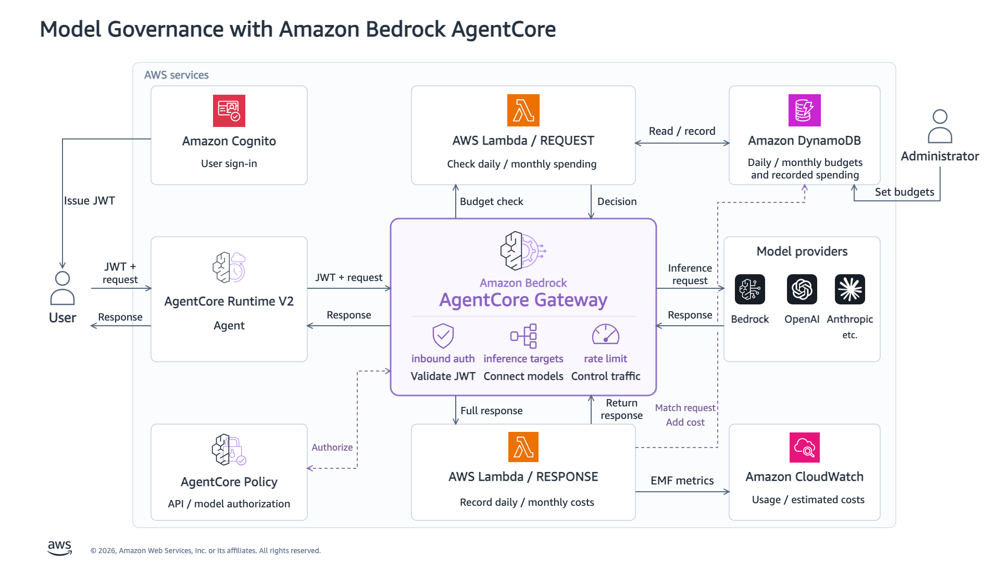

English | [Japanese](README_JA.md)

# Amazon Bedrock AgentCore Gateway: Model Access, Usage, and Budgets

> [!NOTE]
> This repository is not provided by AWS. It is a sample based on verification in one personal environment. My opinions are my own.

Run a small AI coworker built with Strands Agents on Amazon Bedrock AgentCore Runtime V2 and manage its model calls through AgentCore Gateway. Cognito authenticates the user, AgentCore Policy authorizes models, rate limits control traffic, and REQUEST / RESPONSE interceptors check budgets and record model costs.

This personal implementation extends an [AWS usage-interceptor sample](https://github.com/aws-samples/sample-agentcore-gateway-usage-interceptor) while keeping its template and Lambda code unchanged. Use only `runtime_v2/` for this walkthrough; root modules and `scripts/` are legacy prototypes with separate setup and state.

Blog post (Japanese): https://zenn.dev/aws_japan/articles/agentcore-llm-gateway

## Overview and architecture



The request path is `User → Runtime V2 → Gateway → Amazon Bedrock`. A Strands `Agent` runs the model/tool loop with `record_work_item` and `list_work_items` registered through `@tool`. These tools record and inspect in-memory notes; they do not execute the work described in them. The agent returns a written deliverable.

A small custom Strands `Model` adapter sends model calls to Gateway using the existing Messages / Responses APIs with `stream: false`. Model authorization, rate limits, and budget accounting remain with Gateway and the existing REQUEST / RESPONSE Lambda functions and DynamoDB.

| Control | Implementation |
|---|---|
| Authentication | Runtime and Gateway validate Cognito JWTs and require the `llm-gateway-access` group. |
| Model authorization | Policy in `ENFORCE` mode matches the JWT subject, Gateway, API action, and exact model ID. |
| Traffic limits | Gateway applies RPM and concurrent-request limits per JWT `sub`, shared across both model aliases. |
| Budget check | REQUEST Lambda compares recorded spending with each user's daily and monthly caps. |
| Usage accounting | RESPONSE Lambda converts response usage to cost, updates DynamoDB, and emits CloudWatch metrics. |

Runtime allowlists `Authorization`; [agent.py](runtime_v2/agent.py) explicitly forwards the received value to Gateway on every model call. This JWT pass-through is implemented in code. Gateway uses its IAM role to call Bedrock. The Runtime role has no direct Bedrock or budget-table access.

Rate limits are an optional architectural control; this walkthrough configures them. Budgets use post-usage accounting: concurrent requests, the final call, or delayed state can exceed a cap. USD 10 is not a guaranteed ceiling on the AWS bill.

## Prerequisites

- Python 3.11, AWS CLI, and a signed-in AWS profile.
- A Region supporting [Runtime V2](https://docs.aws.amazon.com/bedrock-agentcore/latest/devguide/runtime-how-it-works.html#runtime-platform-versions-regions), the required Gateway features, and the selected inference profiles through the [Messages](https://docs.aws.amazon.com/bedrock/latest/userguide/inference-messages-api.html) / [Responses](https://docs.aws.amazon.com/bedrock/latest/userguide/inference-responses-api.html) APIs.
- Operator permissions for CloudFormation, S3, Cognito, IAM and role passing, AgentCore Runtime/Gateway/Policy/rate limits, Lambda, DynamoDB, KMS, CloudWatch, and the upstream rollover resources.
- Connectivity to AWS APIs and public PyPI. Resource creation and model calls incur charges.

Deployment uses a Python 3.11 Linux ARM64 ZIP in S3. Docker and a local application backend are unnecessary.

## Environment and configuration

Run commands from the repository root. Replace the profile and Region placeholders. For an existing deployment, select its saved state path instead of the new-deployment example below.

```bash
python3.11 -m venv .venv
source .venv/bin/activate
python -m pip install -r runtime_v2/requirements.txt

export AWS_PROFILE="<profile>"
export AWS_REGION="<supported-region>"
export RUNTIME_V2_STATE="$PWD/results/runtime-v2/state.json"
aws sts get-caller-identity
```

Keep command output private. The wrapper discovers the account and checks subsequent operations against the state file's account and Region. `RUNTIME_V2_STATE` selects the deployment for all operator commands.

For a new deployment, prepare a local configuration without overwriting an existing copy:

```bash
mkdir -p local
if [ ! -e local/runtime-v2-config.json ]; then
  cp runtime_v2/config.example.json local/runtime-v2-config.json
fi
```

Review that file before deployment. For an existing deployment, skip configuration creation and deployment, and go to [Keep and reuse the environment](#keep-and-reuse-the-environment).

| Configuration | Supplied value |
|---|---|
| `models.standard` | `global.anthropic.claude-haiku-5-5`, Messages |
| `models.premium` | `global.openai.gpt-6-sol`, Responses |
| `daily_budget_usd` / `monthly_budget_usd` | USD `10` each, per user; reaching either cap stops new calls |
| `rpm` / `concurrency` | `60` requests/minute and `2` concurrent requests per JWT `sub` |
| `max_model_calls` / `max_output_tokens` | `4` attempts per task / `1024` output tokens per model call |
| `max_input_chars` | `12000` characters per task |

`price_table` uses USD per 1,000 tokens and requires `in`, `out`, `cache_read`, `cache_write_5m`, and `cache_write_1h`. Check [current Bedrock prices](https://aws.amazon.com/bedrock/pricing/), model availability, and requested/returned model IDs; example rates are not a current price quote. [Accounting details](runtime_v2/OPERATIONS.md#budgets-and-accounting) explain response-model aliases and cache limitations.

Models, endpoints, and limits are server configuration. Invocation input accepts only `task` and the `standard` / `premium` alias. Configuration changes require a separate deployment and state; per-user budget overrides have their own command.

## Deploy and check status

For a new deployment, choose a state path that does not already exist:

```bash
if [ ! -e "$RUNTIME_V2_STATE" ]; then
  python runtime_v2/manage.py deploy --config local/runtime-v2-config.json
else
  echo "State already exists; follow the reuse or recovery instructions."
fi
python runtime_v2/manage.py status
```

This `deploy` command also deploys the AWS public sample. Its pinned [CloudFormation template](runtime_v2/vendor/usage-interceptor/standalone.yaml) is included in this repository, so you do not need to clone or deploy the upstream sample separately.

| Order | Resources configured automatically |
|---|---|
| Deploy the AWS public sample | Cognito, AgentCore Gateway, REQUEST / RESPONSE Lambda functions and their attachment, DynamoDB, daily/monthly spend rollover, and supporting IAM/KMS resources |
| Add this repository's components | The `bedrock-models` inference provider, demo users and JWT validation rules, AgentCore Policy, rate limits, and Runtime V2 hosting the AI coworker |

The command waits for the upstream stack to reach `CREATE_COMPLETE` before adding the remaining components. [manage.py](runtime_v2/manage.py) creates those additions through Boto3; not all resources belong to one CloudFormation stack. It reports `deployment_complete` after confirming Runtime is `READY`.

Both models use the regional Bedrock Runtime endpoint; deployment resolves and checks the selected inference profiles. No direct OpenAI or Anthropic contract is required.

Readiness can take several minutes. Check Runtime/Gateway `READY`, platform `V2`, Policy `ENFORCE`, and both interceptor points. `status` also reports `runtime_version`, `rate_status`, `rate_entries`, and `verification_recovery_pending`. Deployment exports `client.json` beside state. Keep state and credentials after a failure; see [resume and recovery](runtime_v2/OPERATIONS.md#resume-and-recovery).

## Invoke: success and Policy denial

```bash
python runtime_v2/manage.py invoke --user employee --model standard \
  --task "Plan a one-day onboarding session. Record two work items with record_work_item, inspect them with list_work_items, and return a short plan. Do not claim to have performed the work."

python runtime_v2/manage.py invoke --user employee --model premium \
  --task "Plan a one-day onboarding session. Record two work items with record_work_item, inspect them with list_work_items, and return a short plan. Do not claim to have performed the work."
```

The helper signs in using the private demonstration-user credentials. Runtime returns the existing synchronous JSON result after the Strands model/tool loop finishes. Strands' internal events do not provide progressive streaming to the caller; Gateway model requests still use `stream: false`. Inspect `result.status`, `answer`, `work_items`, and `model_calls`; model output is nondeterministic.

| User | `standard` | `premium` |
|---|---|---|
| `employee` | Allowed | Allowed |
| `restricted` | Allowed | Denied by Policy |
| `outsider` | Rejected: no access-group membership | Rejected: no access-group membership |

Compare authorization for the same user:

```bash
python runtime_v2/manage.py invoke --user restricted --model standard \
  --task "Describe your note-taking tools in one sentence."
python runtime_v2/manage.py invoke --user restricted --model premium \
  --task "Describe your note-taking tools in one sentence."
```

The premium request should return `result.status="stopped"`, `stop_reason="POLICY_DENIED"`, and `gateway_status=403`. Handled stops also use outer HTTP `200`; HTTP success alone is not task success. The CLI exits `0` only for `completed`, and `2` for a stopped/failed invocation. The agent does not retry or switch models. See [response handling](runtime_v2/OPERATIONS.md#responses-and-stops) and the [end-user client](runtime_v2/OPERATIONS.md#end-user-client).

## Run end-to-end verification

```bash
python runtime_v2/verify.py
```

This runs billable AWS checks and writes private `verification.json` beside the state. It checks configuration, JWT/group rejection, both model/tool loops, spending and CloudWatch usage, model authorization, rate rejection, and budget rejection.

Verification temporarily adds probe-specific rate entries, then restores the original entries. It sets a dedicated probe's recorded spending and caps to USD 10; it does not spend USD 10 to test the budget or alter the employee's caps. Probe users are disabled afterward. If a recovery file remains, verification stops; use `python runtime_v2/manage.py restore-verification --yes` as described in [recovery](runtime_v2/OPERATIONS.md#resume-and-recovery).

The verifier archives prior reports under `verification-history/` and records terminal status (`PASSED`, `FAILED`, or `INTERRUPTED`) with timestamps. A new AWS E2E run has not been performed for the Strands migration or the latest management and verification changes. Earlier results in [VERIFICATION.md](runtime_v2/VERIFICATION.md) do not certify them. See [verification details](runtime_v2/OPERATIONS.md#verification-and-manual-checks).

## Keep and reuse the environment

Keep the deployed resources for further use; cleanup is a separate, optional action. Preserve the entire private state directory, including the state JSON, `<state-stem>-credentials.json`, and recovery evidence. Running `deploy` with a new state path creates a separate deployment.

In a later shell, activate the Python environment and select the original AWS environment and saved state:

```bash
source .venv/bin/activate
export AWS_PROFILE="<original-profile>"
export AWS_REGION="<original-region>"
export RUNTIME_V2_STATE="<absolute-path-to-existing-state.json>"
python runtime_v2/manage.py status
python runtime_v2/manage.py budget --user employee
python runtime_v2/manage.py invoke --user employee --model standard \
  --task "Record two preparation tasks for a team meeting and give a short agenda."
```

Routine invocations do not require another `deploy`. To apply the Strands migration to an existing Runtime V2 deployment, update Python dependencies, export the saved configuration, and deploy with the same profile, Region, and state:

```bash
python -m pip install -r runtime_v2/requirements.txt &&
python runtime_v2/manage.py export-config --output local/runtime-v2-saved-config.json &&
python runtime_v2/manage.py deploy --config local/runtime-v2-saved-config.json &&
python runtime_v2/manage.py status
```

This updates the agent artifact on the existing Runtime V2 and reuses its Gateway, Cognito, Policy, rate limits, interceptors, and DynamoDB table. Use the same procedure to resume deployment or apply later code changes. Export writes only saved configuration and refuses an existing output path; choose a new filename if necessary. Use this configuration for an existing deployment rather than the example defaults. Keep state, credentials, exported configuration, and results private. See [OPERATIONS.md](runtime_v2/OPERATIONS.md) for recovery and client access. Do not run cleanup during normal reuse.

## Optional cleanup

Skip this while retaining the environment. When you explicitly decide to remove it, select its original profile, Region, and state, then run:

```bash
python runtime_v2/cleanup.py --yes
```

Cleanup deletes the owned deployment and marks local state as deleted. The upstream template retains the spend table, KMS key, rollover archive bucket, and Lambda versions; CloudWatch logs are not purged. Data and charges can remain. Inspect the private state's `stack_resources` and actual remaining resources; keep the key while encrypted data depends on it. See [retained resources](runtime_v2/OPERATIONS.md#cleanup-and-retained-resources).

## Scope and sources

Work items and history last for one invocation. This implementation has no arbitrary execution tools, progressive streaming, token reservation, automatic model fallback, or human approval workflow. Token-cost counters exclude other AWS service charges and can miss accounting failures; they do not guarantee a strict budget.

- Implementation: [manage.py](runtime_v2/manage.py), [agent.py](runtime_v2/agent.py), [config.example.json](runtime_v2/config.example.json), and [operations](runtime_v2/OPERATIONS.md).
- AWS guidance: [inference providers](https://docs.aws.amazon.com/bedrock-agentcore/latest/devguide/gateway-target-inference-provider.html), [Policy](https://docs.aws.amazon.com/bedrock-agentcore/latest/devguide/policy.html), [interceptors](https://docs.aws.amazon.com/bedrock-agentcore/latest/devguide/gateway-interceptors.html), and [rate enforcement](https://docs.aws.amazon.com/bedrock-agentcore/latest/devguide/gateway-rate-limits-enforcement.html).
- Upstream: [pinned template](https://github.com/aws-samples/sample-agentcore-gateway-usage-interceptor/blob/d79bd57f6d5461b81f862630961b72c49967a4f9/cloudformation/standalone.yaml), [SOURCE.json](runtime_v2/vendor/usage-interceptor/SOURCE.json) with its SHA-256 and `changes: "none"`, and [MIT No Attribution license](runtime_v2/vendor/usage-interceptor/LICENSE). The wrapper has its own [MIT license](LICENSE).
