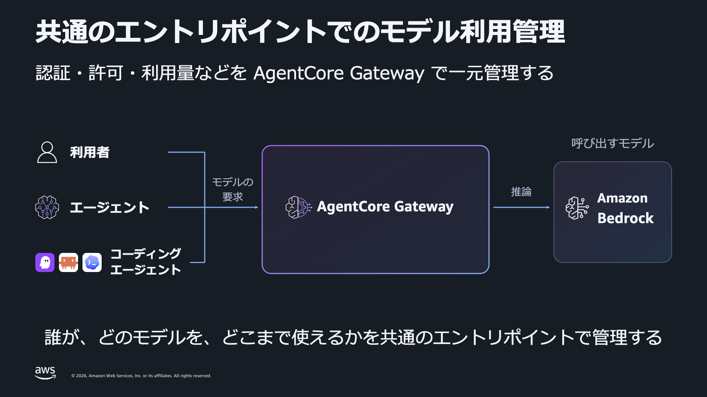
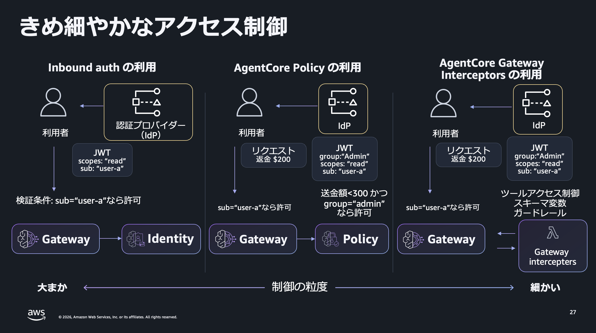
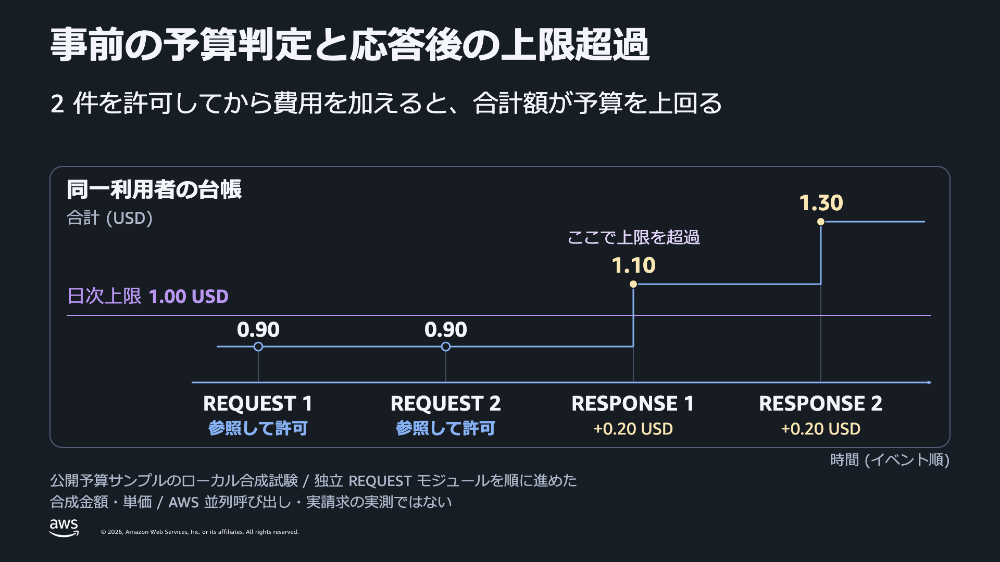

[English](README.md) | 日本語

# Amazon Bedrock AgentCore Gateway: LLM Gateway Samples

> [!NOTE]
> 個人の AWS 環境で試すためのサンプルであり、AWS 公式の提供物ではない。AWS 上の検証状況は後述する。

1 つの Amazon Bedrock AgentCore Gateway で 3 人の利用者を認証し、利用できるモデルを制御し、特定の利用者とモデルの組み合わせに個別の rate limit を適用する。アプリケーションは native モデルイベントを逐次出力し、高性能モデルの専用上限と確認できた拒否に対して、標準モデルを 1 回だけ呼び出す。

## Scenario

| 利用者 | 標準: Claude Haiku 5.5 | 高性能: Claude Opus 5.5 |
|---|---|---|
| A | 許可、通常の上限 | 許可、通常の上限 |
| B | 許可、通常の上限 | モデルの認可で拒否 |
| C | 許可、通常の上限 | 許可、低い個別上限 |

3 人とも同じ Cognito ユーザープールで認証する。C は標準モデルを直接選べる。高性能モデルを選び、その専用上限と確認できた HTTP 429 が返った場合だけ、アプリケーションが標準モデルを 1 回呼び出す。B の認可拒否では切り替えない。

モデル名はサンプルで想定する役割を示す。利用先のアカウントとリージョンで有効な inference profile を選ぶ。モデル ID に既定値はない。「通常の上限」には、適用される共通上限とサービスクォータが含まれる。

## Architecture





図は設計上の責務を示し、サービスの処理順を示すものではない。英語版と日本語版は同じ日本語の図を使用する。

| 責務 | サンプルで使う仕組み |
|---|---|
| 呼び出し元の識別 | Cognito access token と Gateway の JWT inbound authorizer |
| 3 人の principal の許可 | `ENFORCE` モードの AgentCore Policy |
| 要求モデルの認可 | REQUEST interceptor で検証済み JWT の subject と URI のモデル ID を完全一致で確認 |
| C の高性能モデル利用量の制限 | 利用者とモデルの次元を組み合わせた専用の Gateway rate limit |
| Amazon Bedrock の呼び出し | `bedrock-runtime` inference connector と Gateway 専用 IAM ロール |
| 専用上限の拒否後に利用を継続 | アプリケーション側で 1 回だけ追加要求 |
| 任意の日次・月次予算 | REQUEST のモデル認可後に予算判定。RESPONSE で利用量台帳へ計上 |

クライアントは [native InvokeModelWithResponseStream](https://docs.aws.amazon.com/bedrock-agentcore/latest/devguide/gateway-target-inference-invokemodel.html) を使用する。

```text
POST /inference/model/{URL-encoded-model-id}/invoke-with-response-stream
```

`examples/request.json` は `anthropic_version`、`max_tokens`、`messages` を持つ [Anthropic Messages の本文](https://docs.aws.amazon.com/bedrock/latest/userguide/model-parameters-anthropic-claude-messages.html) である。モデルとストリーミング操作は URI で選ぶ。本文に `model` と `stream` は指定しない。

[Gateway の rate limit は Gateway ルールより先に評価される](https://docs.aws.amazon.com/bedrock-agentcore/latest/devguide/gateway-rate-limits-enforcement.html)。そこで拒否された要求は Gateway の fallback ルールへ進まない。このため、アプリケーションが専用上限の拒否を識別し、同じ Gateway へ同じ JWT とシリアライズ済み本文で追加要求を送る。変更するのは URI のモデル ID だけである。[Gateway の fallback ルール](https://docs.aws.amazon.com/bedrock-agentcore/latest/devguide/gateway-rules-fallback.html) は、別途、設定された接続先の失敗を扱う。

## Structure

```text
.
├── scripts/
│   ├── common.py              AWS 設定、リソース台帳、テスト利用者の認証
│   ├── setup.py               Cognito 利用者、Gateway ロール、JWT Gateway、connector
│   ├── check_sdk_version.py   SDK 機能のローカル確認
│   ├── configure_access.py    Principal の Policy と URI によるモデル認可
│   ├── native_access.py       認可を行う REQUEST Lambda のデプロイ
│   ├── configure_limits.py    C と高性能モデルの専用 rate limit
│   ├── invoke_user.py         A/B/C として認証・呼び出し
│   ├── verify_controls.py     権限表と、個別上限からの切り替えを検証
│   ├── configure_budget.py    任意の予算構成のデプロイ
│   ├── verify_budget.py       native 計上・予算拒否の検証と上限の復元
│   └── cleanup.py             この実行の台帳に記録したリソースだけを確認・削除
├── gateway_fallback.py        HTTP クライアント、キー完全一致の切り替え、逐次デコード
├── invoke.py                  既存 Gateway と JWT を使う低レベルの CLI
├── access_interceptor.py      Subject とモデルの完全一致による認可。任意の予算判定を合成
├── budget_interceptors.py     Native 要求の予算判定と応答の利用量計上
├── examples/
│   ├── request.json           Anthropic native リクエスト
│   ├── offline_demo.py        合成応答による 6 シナリオ
│   ├── rate-limit.example.json
│   ├── limit-keys.example.json
│   └── prices.example.json    単価ファイルの形式。価格は合成値
├── tests/                    fixture によるローカルテスト
├── images/ja/                日本語の図
├── requirements.txt          Python 依存パッケージ
└── results/                  リソース台帳と非公開の実行結果 (gitignored)
```

## Prerequisites

- Python 3.11 以上を使用する。`requirements.txt` は Boto3 と Botocore を `1.43.111` に固定している。
- AWS CLI と設定済みの AWS profile が必要である。スクリプトの実行前に、その profile の通常のサインインを完了する。
- 使用する機能に対応したリージョンと、利用権限のある 2 つの有効な Bedrock inference profile が必要である。両モデルが同じ native 本文と必要な機能を受け付ける必要がある。
- このサンプルの Cognito、IAM、Gateway、Policy、rate limit、Lambda、CloudWatch Logs を作成・削除する権限と、実行ロールを渡す権限が必要である。任意の予算構成では DynamoDB も使用する。

AWS 上のセットアップと呼び出しはリソースを作成し、料金が発生し得る。オフラインデモは AWS リソースを使用しない。

## Setup

```bash
git clone https://github.com/SeongHaedu/amazon-bedrock-agentcore-gateway-llm-gateway-samples.git
cd amazon-bedrock-agentcore-gateway-llm-gateway-samples

python3 -m venv .venv
source .venv/bin/activate
python -m pip install -r requirements.txt
```

以降のコマンドはリポジトリ直下で実行する。

### Select the AWS environment

Profile の placeholder を置き換える。Profile のリージョンを使わない場合は、先に `AWS_REGION` を指定する。未指定なら次のコマンドが profile から取得する。どちらにも設定がなければ、設定を求めるエラーになる。

```bash
export AWS_PROFILE='<your-profile>'
export AWS_REGION="${AWS_REGION:-$(aws configure get region --profile "$AWS_PROFILE")}"
: "${AWS_REGION:?Set AWS_REGION to a Region supported by your selected features and models}"
```

Python スクリプトは STS `GetCallerIdentity` の応答からアカウントと partition を取得する。Gateway endpoint、リソース ID、ARN は AWS の応答とローカル台帳から取得する。README やソースコードへのアカウント ID、endpoint、ARN の転記は不要である。

### Select the two inference profiles

```bash
aws bedrock list-inference-profiles \
  --region "$AWS_REGION" \
  --query 'inferenceProfileSummaries[].[inferenceProfileId,inferenceProfileName,status]' \
  --output json

export PRIMARY_MODEL_ID='<high-performance-inference-profile-id-or-arn>'
export FALLBACK_MODEL_ID='<standard-inference-profile-id-or-arn>'
```

`PRIMARY_MODEL_ID` (`--model high`) に高性能モデル、`FALLBACK_MODEL_ID` (`--model standard`) に標準モデルの profile を指定する。利用環境で有効な、異なる 2 つの profile を選ぶ。ある地理プレフィックスが別のリージョンでも使えるとは扱わない。

`setup.py` は各値を `GetInferenceProfile` で解決し、`ACTIVE` を要求する。モデル呼び出し権限は、返された profile とモデルの ARN に限定する。モデル一覧の取得権限は別の statement で `Resource: "*"` を使う。Profile の取得に成功したことだけでは、モデルを呼び出せるとは確認できない。

### Keep the run's resource ledger

既定の台帳は `results/resources.json` である。別の台帳を使う場合は、セットアップ前に次を設定し、以降のコマンドでも維持する。

```bash
export GATEWAY_STATE_FILE='results/my-run/resources.json'
```

セットアップは既存の台帳を上書きしない。以降のスクリプトは、選択したアカウント、partition、リージョンが台帳と一致するか確認する。セットアップに失敗した場合も台帳を残す。削除時に、記録済みリソースと成否未解決の作成処理を確認するためである。共通の SDK クライアントは自動再試行を無効にし、総試行回数の上限を 1 回に設定する。

## Step 0: Check the SDK

```bash
python scripts/check_sdk_version.py
```

認証情報や AWS 呼び出しを使わず、インストール済み Botocore のサービスモデルを読む。スクリプトが必要とする Gateway authorizer、Policy、interceptor、inference target、rate limit の定義を確認する。`missing_capabilities` が空で終了コードが `0` なら成功である。SDK に定義があることと、対象リージョンでの提供や AWS の権限は別に確認する。

## Step 1: Create the Gateway and test users

```bash
python scripts/setup.py
```

実行ごとに、Cognito ユーザープール、アプリケーションクライアント、テスト利用者 3 人、専用 IAM ロールとインラインポリシー、JWT 認証の Gateway、`bedrock-runtime` inference connector target を作成する。利用者の作成時に招待メッセージを送らない。

JWT authorizer は、このサンプルのアプリケーションクライアント ID を受け入れる。ロールの信頼条件を作成済み Gateway に絞り、Gateway と target が `READY` になるまで状態を確認する。リソースの識別情報は台帳に記録する。

この手順で構築するのは認証と推論の接続である。他の呼び出し元に Gateway を使わせる前に、モデルの認可を設定・検証する。

## Step 2: Configure model authorization

```bash
python scripts/configure_access.py
python scripts/verify_controls.py
```

2 つの制御を設定する。強制モードの Policy Engine で、記録済みの 3 人の principal を許可する。そのうえで REQUEST Lambda が、Gateway 検証済み JWT の `sub` と native URI からデコードしたモデル ID の完全一致で認可する。A/C は両モデル、B は標準モデルだけを利用できる条件である。許可リストと期待する Gateway の識別情報は、この実行の台帳から生成する。

Native Policy の実測では、`context.input` は存在したが、`context.input has model` は false だった。呼び出し元が本文に指定する `model` は、URI が実際に選択するモデルに結び付かない。このため、[Chat Completions のポリシー例](https://docs.aws.amazon.com/bedrock-agentcore/latest/devguide/example-policies-action-resource.html) を native モデル認可の根拠にはできない。本サンプルは `access_interceptor.py` でモデルを認可し、Policy 単独で権限表を強制できるとは主張しない。

Interceptor は対応する native POST パスだけを受け付け、期待する Gateway context とモデル ID の完全一致を確認する。JWT の署名は自ら検証せず、Gateway の JWT 検証を前提とする。デプロイ時に Lambda の呼び出し元を Gateway に限定し、リクエストヘッダーを interceptor へ渡す。

Rate limit を作成する前に認可を検証する。検証スクリプトは推論 endpoint へ 7 回要求する。無効 token の 1 回に HTTP 401 を期待し、続いて利用者とモデルの全 6 組を確認する。B/high は HTTP 403、他の 5 組は HTTP 200 とストリーム完了を要求する。成功すると台帳へ `verification.access = "passed"` を記録する。レポートは台帳と同じディレクトリの `verify-access.json` に保存し、失敗時は非ゼロで終了する。次の手順にはこの成功記録が必要である。

## Step 3: Configure C's dedicated rate limit

1 分当たりの正のリクエスト上限を選ぶ。次の例は 240 を使用する。CLI に既定値はない。

```bash
export PREMIUM_RPM='240'
python scripts/configure_limits.py --premium-rpm "$PREMIUM_RPM"
```

C の JWT subject と選択した高性能モデルを組み合わせた 1 つの上限を、`period: "minute"` で作成・更新する。設定反映のために 31 秒待ち、以前に検証した切り替え用キーを消去する。CLI は有限の正数を受け付ける。ゼロは Step 5 の分離検証だけで使用する。

[Rate limit の次元](https://docs.aws.amazon.com/bedrock-agentcore/latest/devguide/gateway-rate-limits-dimensions.html) には `$.context.jwt.sub` と `qualifiedModelId` がある。Step 5 で実際の拒否の完全なキーを、この設定と照合する。`examples/rate-limit.example.json` は SDK 入力形式の例であり、このコマンドでは適用しない。

新規・未使用期間の長い上限は [最初に設定レートより多く通過させる場合がある](https://docs.aws.amazon.com/bedrock-agentcore/latest/devguide/gateway-rate-limits-enforcement.html)。毎分 1 回と設定しても、60 秒ごとに厳密に 1 回しか通さない境界とは扱えない。固定の要求件数だけでは拒否を確実に再現できない。

## Step 4: Invoke as each user

```bash
python scripts/invoke_user.py --user a --model standard
python scripts/invoke_user.py --user a --model high
python scripts/invoke_user.py --user b --model standard
python scripts/invoke_user.py --user b --model high
python scripts/invoke_user.py --user c --model standard
python scripts/invoke_user.py --user c --model high
```

ラッパーは指定したテスト利用者の token を取得し、保存済みのリソース識別情報で Gateway を呼び出す。共通の認証ヘルパーは、その利用者のパスワードを新たに生成し、Cognito の管理認証で access token を取得する。Token はメモリ内で扱う。

B の高性能モデルは認可で拒否されることを期待する。C の高性能モデルは専用上限未満なら通常のストリームを返すことを期待する。上の 6 コマンドは最初の要求の結果を確認するため、切り替えを無効にしたまま呼び出す。

ラッパーは利用者・status・試行モデルの要約に続いて native イベントの JSON を出力する。ストリーム完了なら `0`、拒否や失敗なら非ゼロで終了する。`--prompt` でプロンプトを変更し、`--max-tokens` で 1 から 4096 の値を指定できる。既定値は 24 である。Step 5 で切り替え経路を検証して有効にする。

既存の `invoke.py` は JSON Lines を出力し、native モデルイベントを受け取るたびに flush する。

| イベント | 意味 |
|---|---|
| `gateway_response` | 要求・試行モデル、最終 HTTP status、切り替えの判断 |
| `model_event` | テキスト、thinking、usage の構造を維持した Anthropic native イベント |
| `complete` | ストリーム完了。取得できた場合は `message_start` が示すモデルを含む |
| `http_error` / `client_error` | 最終的な HTTP 拒否、または入力・通信・ストリームの失敗 |

終了コードは、ストリーム完了が `0`、最終 HTTP 応答が 200 以外なら `1`、入力・通信・ストリームの失敗が `2` である。途中まで出力した後に失敗する場合がある。

既存 Gateway を使う場合、`invoke.py` は `GATEWAY_ENDPOINT`、両モデルの環境変数、任意の `FALLBACK_LIMIT_KEYS_FILE` を読む。`GATEWAY_BEARER_TOKEN` がなければ JWT を非表示のプロンプトで受け取る。検証済みの完全一致キーの許可リストがなければ切り替えは無効である。`.env.example` は参考ファイルであり、自動では読み込まない。

## Step 5: Verify the controls on AWS

```bash
python scripts/verify_controls.py --limits
```

Step 2 で無効 token の拒否と利用者・モデルの全 6 組の確認に成功してから実行する。このコマンドは C の高性能モデル専用 rate だけを一時的にゼロにし、上限の分離と切り替えを確認する。最初に、台帳に保存された正の rate が実際の専用設定と一致するか確認する。

| 専用 rate がゼロの間の確認点 | 期待する動作 |
|---|---|
| C/high | HTTP 429 と、この利用者・モデル専用上限の完全なキー |
| C/standard | HTTP 200 とストリーム完了 |
| A/high | HTTP 200 とストリーム完了 |
| B/high | HTTP 403 |
| アプリケーションの切り替えを有効にした C/high | HTTP 200、標準モデルへの 1 回の切り替え、合計 2 試行、ストリーム完了 |

ゼロへの変更後に 31 秒待ち、`finally` で元の正の rate に戻した後も設定反映を 31 秒待つ。これは上限の分離と切り替えの検証であり、正の rate に対する継続負荷の精度試験ではない。5 つの確認を行い、切り替えが 2 回の要求を使うため、推論 endpoint への要求は合計 6 回となる。

native 応答の `limitKey` は rate の識別子だけを含む。検証では、その rate に C とモデルの専用エントリだけが設定されていることを確認し、拒否と分離の確認後に応答のキーを `verified_fallback_limit_keys` へ登録する。同じ識別子を共有上限へ転用せず、対象を変えた場合は再検証する。キーの手動転記は不要である。レポートは台帳と同じディレクトリの `verify-limits.json` に保存する。確認に失敗した場合は切り替え用キーを消去する。

検証に成功した後、対話的な呼び出しで切り替えを有効にする。

```bash
python scripts/invoke_user.py --user c --model high --fallback
```

この要求には復元した正の rate が適用されるため、その専用上限で実際に拒否された場合だけ切り替える。`--fallback` を付けても、一致する検証済みキーがなければモデルを切り替えない。

中断や復元の失敗により、台帳の `rate_restore_required` が `true` のまま残った場合は、元の正の rate に戻してから続行するか、この実行を削除する。

```bash
python scripts/configure_limits.py --premium-rpm "$PREMIUM_RPM"
```

Step 3 で選んだ元の値を使う。再設定で検証済みキーが消えるため、切り替えを使う前に `verify_controls.py --limits` を再実行する。台帳とレポートは環境識別情報を含む場合があるため、Git 管理対象外の `results/` に保存する。

## Step 6 (optional): Add daily and monthly budgets



Rate limit は短時間の要求量を数える。金額予算には利用量、単価、累計費用が必要である。任意の追加構成では、REQUEST で利用者の日次・月次の既存合計を確認し、RESPONSE でモデル応答後の利用量を価格へ換算して加算する。

[参照した固定版の公開予算サンプル](https://github.com/aws-samples/sample-agentcore-gateway-usage-interceptor/tree/d79bd57f6d5461b81f862630961b72c49967a4f9) は、本サンプルの native URI/EventStream 経路にそのまま適用できない。ローカルの互換性検証 6 ケースでこの制限を確認した。本リポジトリは別の native adapter を提供する。

選択した両モデルに実際に適用される単価を入力し、`local/prices.json` を作成する。コマンドは台帳からモデル ID を取得し、通常入力、出力、cache read、5 分の cache write、1 時間の cache write の 100 万 token 当たり USD 単価をすべて質問する。既存ファイルは上書きしない。

```bash
python -c '
import json
import os
from decimal import Decimal, InvalidOperation
from pathlib import Path

path = Path("local/prices.json")
if path.exists():
    raise SystemExit("local/prices.json already exists; review and edit it explicitly.")
state_path = Path(os.environ.get("GATEWAY_STATE_FILE") or "results/resources.json")
state = json.loads(state_path.read_text())
fields = (
    "input_per_million_usd",
    "output_per_million_usd",
    "cache_read_per_million_usd",
    "cache_write_5m_per_million_usd",
    "cache_write_1h_per_million_usd",
)
prices = {}
for label in ("standard", "premium"):
    model_id = state["models"][label]["id"]
    rates = {}
    print(f"Enter applicable prices for {label}: {model_id}")
    for field in fields:
        raw = input(f"{field} (USD per million tokens): ").strip()
        try:
            value = Decimal(raw)
        except InvalidOperation:
            raise SystemExit(f"Invalid decimal for {field}")
        if (not value.is_finite() or value < 0 or value > Decimal("1e12")
                or value.as_tuple().exponent < -12):
            raise SystemExit("Use a finite nonnegative rate with at most 12 decimal places.")
        rates[field] = str(value)
    prices[model_id] = rates
path.parent.mkdir(parents=True, exist_ok=True)
with path.open("x", encoding="utf-8") as output:
    json.dump(prices, output, indent=2)
    output.write("\n")
path.chmod(0o600)
print("Created local/prices.json")
'
```

`examples/prices.example.json` の単価はテスト用の合成値であり、実際の価格ではない。実単価として転記せず、不明な単価をゼロで埋めない。Adapter は、未使用の分類を含めた 5 項目すべてに、有限かつ非負の単価を要求する。

```bash
export DAILY_BUDGET_USD='<daily-decimal-usd>'
export MONTHLY_BUDGET_USD='<monthly-decimal-usd>'
python scripts/configure_budget.py \
  --prices local/prices.json \
  --daily "$DAILY_BUDGET_USD" \
  --monthly "$MONTHLY_BUDGET_USD"
```

デプロイは既存の `access-request` Lambda を REQUEST interceptor として維持する。Handler は利用者とモデルを完全一致で認可した後、`ENABLE_BUDGET=true` の場合に予算の REQUEST handler を呼び出す。`MODEL_ACCESS_JSON` と `EXPECTED_GATEWAY_ARN` を保持し、予算の RESPONSE Lambda と DynamoDB による計上を追加する。予算の有効化でモデル認可を置き換えない。

予算上限の超過だけでは拒否せずに費用を計上する場合は、デプロイコマンドに `--observe` を付ける。モデル認可と、設定・識別情報・単価・ストレージの異常に対する確認は維持する。既定では予算上限による拒否を有効にする。

モードは最初の予算デプロイ前に選ぶ。スクリプトは予算の実行記録がある場合に再実行を拒否し、途中で失敗した有効化を自動再開・ロールバックしない。失敗時は台帳を保持して記録済みの段階と変更処理を確認するか、この実行を削除する。Gateway の設定コマンドは順番に実行する。

Lambda の ZIP には認可と予算のモジュールを含める。Boto3/Botocore は Python 3.12 ランタイムに同梱されたものを使い、`requirements.txt` の固定バージョンはローカルのデプロイ環境に適用する。

[HTTP/inference の RESPONSE interceptor は応答全体を buffer する](https://docs.aws.amazon.com/bedrock-agentcore/latest/devguide/gateway-interceptors-types.html#gateway-interceptors-types-http)。この手順を追加するとストリーミング体験が変わる。クライアントでイベントを解析できても、Gateway は応答全体を待ってから interceptor に処理させる。クライアントの逐次デコードを、このオプション有効時のリアルタイムな token 配信の根拠にしない。

Adapter は要求を Gateway と JWT subject に対応付け、受け付け時点の UTC の日付・月と単価表を固定し、日次・月次のモデル費用見積額を記録する。RESPONSE は完了した native Anthropic Messages EventStream の usage に対応する。欠落・未完了・未対応の usage は未計上であり、費用ゼロとは扱わない。応答側の計上に失敗した場合は、モデル応答を変更せず、計上状態を未記録として報告する。

時系列図は応答後の費用加算を示し、予算額の事前予約を示すものではない。並行要求や受け付け済みの要求によって上限を超える場合がある。予算による拒否は HTTP 403 と `BUDGET_EXCEEDED` を返し、切り替えの対象にしない。モデル単価による見積額は AWS 請求と基盤費用から区別する。

強制モードでは、native 応答の費用が日次・月次の両台帳へ計上されることを確認し、その後 REQUEST の日次 cap を一時的にゼロにして、予算拒否とモデル認可の維持を確認する。

```bash
python scripts/verify_budget.py
```

元の cap は正の値にし、A の最初の標準モデル要求が通る予算を残しておく。試験は 4 回の要求で、A/standard の成功後、A/standard と C/high の予算拒否、B/high のモデル認可による拒否を確認する。拒否時に切り替えは行わない。元の REQUEST 環境変数は `finally` で復元し、台帳と同じディレクトリに `verify-budget.json` を保存する。これは応答後の計上とゼロ cap の拒否を確認する試験であり、同時実行時の厳密な支出上限の試験ではない。中断で台帳に `budget_restore_variables` が残った場合はファイルを保持し、その実行をクリーンアップしてからやり直す。

## Step 7: Clean up

セットアップ時と同じ AWS profile、リージョン、`GATEWAY_STATE_FILE` を使用する。

```bash
python scripts/cleanup.py
python scripts/cleanup.py --yes
```

最初のコマンドは台帳を読み、削除候補を表示するだけで削除しない。2 つ目は、この実行に記録されたリソースを削除する。削除処理は選択したアカウント・partition・リージョンを確認し、実装されている照合項目について保存済みの識別情報と実リソースを照合する。アカウント全体を一括削除する処理ではない。

削除後も台帳を保持し、削除の進捗を記録する。残存リソースや成否未解決の作成処理が報告された場合は、ファイルを残して対象を確認する。失敗・中断した作成処理は、記録済みリソースが残っていない場合も確認が必要となり得る。新しい実行では別の台帳パスを指定する。セットアップは以前の台帳を上書きしない。

## Verification status

クライアントのローカル確認は AWS を使わずに実行できる。

```bash
python -m unittest discover -s tests -v
python examples/offline_demo.py
```

ローカルのテストスイートは fixture を使い、クライアントの動作、native モデルの認可、予算の解析・計上を確認する。オフラインデモは A/B/C の合成応答を 6 シナリオ分返す。これらは AWS の JWT 検証、Policy 評価、rate limit の精度、ルーティング、予算構成のデプロイを確認するものではない。

2026 年 10 月 28 日に、シナリオの 2 モデルへの native streaming 呼び出しで次を確認した。

| 確認項目 | 実測結果 |
|---|---|
| 無効 JWT と利用者・モデルの 6 組 | 無効 JWT は 401、A/C は両モデルで完了、B は標準モデルで完了し高性能モデルは 403 |
| C/high の専用 rate を一時的にゼロへ変更 | C/high は 429、C/standard と A/high は完了、B/high は 403 を維持 |
| 専用上限の拒否に対するアプリケーションの切り替え | C は合計 2 試行で標準モデルの応答を完了 |
| native 予算計上 | 応答完了後、日次・月次の両台帳に同じ正の金額を加算 |
| REQUEST の日次 cap を一時的にゼロへ変更 | A/standard と C/high は BUDGET_EXCEEDED、B/high は MODEL_ACCESS_DENIED、切り替えなし |

rate と予算の設定は各試験後に復元した。単価は合成値であり、請求額の正確性を検証した結果ではない。この限定した試験では、正の rate による継続負荷の精度、本番の同時実行、厳密な金額上限は測定していない。実環境の識別子を含む台帳と生の試験結果はコミットしない。

検証 run の台帳に記録したリソースは、`scripts/cleanup.py` ですべて削除した。

## Notes and current limits

- 切り替えには、高性能モデルへの最初の要求、HTTP 429、解釈できる曖昧でない JSON エラー、許可した完全な `limitKey` との完全一致が必要である。不明・共通の上限、認可の失敗、不正なエラー、通信失敗、サーバーエラーでは切り替えない。追加要求を再試行することもない。
- HTTP 200 を受け入れた後は、最初のテキストより前でも再試行やモデル切り替えをしない。EventStream フレームの破損、切断、native error イベント、`message_stop` の欠落はストリームの失敗となる。
- クライアントは Botocore のフレーム・CRC 検証を使い、`application/vnd.amazon.eventstream` を逐次デコードする。ライブラリの `iter_chunks()` は envelope を検査し、CLI は Anthropic の完了イベントも検査する。ライブラリでは返り値を context manager として使い、途中で読むのを止めた接続も閉じる。
- 両モデルが同じ本文と機能を受け付ける必要がある。モデル ID の変更による本文の形式変換は行わない。
- 要求モデル、試行した URI のモデル、応答が示すモデルは異なる根拠である。ルーティングルールが接続先を変更する場合があるため、実際に応答したモデルは応答とルーティングログで確認する。
- TLS 証明書の検証を有効に保ち、redirect を拒否し、HTTP クライアントでは環境変数の proxy を使わない。
- 台帳、完全な limit key、JWT、非公開の実行用単価、生の応答はローカルの Git 管理対象外ファイルに保存する。`results/` 以外の台帳パスを指定する場合は、そのパスも Git 管理から除外する。
- 任意の応答後予算計上はストリーミングの待ち時間を変え、厳密な支出上限を保証しない。Native API との互換性は、実際にデプロイした構成で確認する必要がある。

## References

- [Inference targets](https://docs.aws.amazon.com/bedrock-agentcore/latest/devguide/gateway-targets-inference.html) と [inference connectors](https://docs.aws.amazon.com/bedrock-agentcore/latest/devguide/gateway-target-inference-connector.html)。
- [Gateway 経由の native InvokeModel API](https://docs.aws.amazon.com/bedrock-agentcore/latest/devguide/gateway-target-inference-invokemodel.html)。
- [JWT inbound authorization](https://docs.aws.amazon.com/bedrock-agentcore/latest/devguide/inbound-jwt-authorizer.html)。
- [Policy の認可フロー](https://docs.aws.amazon.com/bedrock-agentcore/latest/devguide/policy-authorization-flow.html) と [action/resource のポリシー例](https://docs.aws.amazon.com/bedrock-agentcore/latest/devguide/example-policies-action-resource.html)。
- [Rate limit の次元](https://docs.aws.amazon.com/bedrock-agentcore/latest/devguide/gateway-rate-limits-dimensions.html) と [評価方法](https://docs.aws.amazon.com/bedrock-agentcore/latest/devguide/gateway-rate-limits-enforcement.html)。
- [Gateway の model fallback](https://docs.aws.amazon.com/bedrock-agentcore/latest/devguide/gateway-rules-fallback.html)。
- [HTTP/inference interceptors と応答の buffering](https://docs.aws.amazon.com/bedrock-agentcore/latest/devguide/gateway-interceptors-types.html#gateway-interceptors-types-http)。
- [Claude Haiku 5.5 モデルカード](https://docs.aws.amazon.com/bedrock/latest/userguide/model-card-anthropic-claude-haiku-5-5.html) と [Claude Opus 5.5 モデルカード](https://docs.aws.amazon.com/bedrock/latest/userguide/model-card-anthropic-claude-opus-5-5.html)。
- [Anthropic Messages のパラメータ](https://docs.aws.amazon.com/bedrock/latest/userguide/model-parameters-anthropic-claude-messages.html)。
- [Gateway の observability](https://docs.aws.amazon.com/bedrock-agentcore/latest/devguide/observability-gateway-metrics.html) と [AgentCore の料金](https://aws.amazon.com/bedrock/agentcore/pricing/)。
