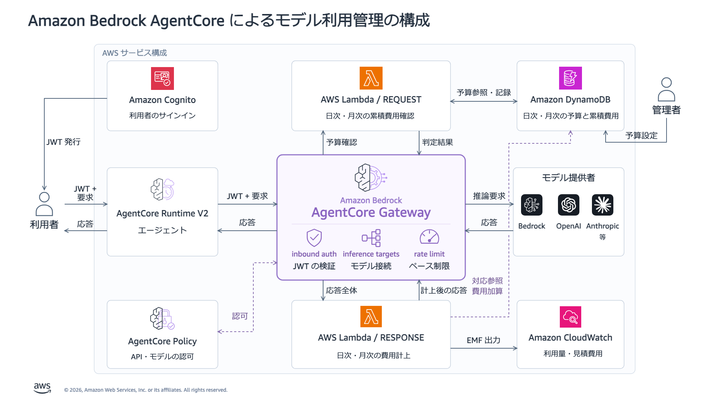

[English](README.md) | Japanese

# Amazon Bedrock AgentCore Gateway によるモデル利用の認証・認可と利用量・予算管理サンプル

> [!NOTE]
> 本リポジトリは AWS 公式が提供するものではなく、あくまで個人の環境での検証結果に基づいたサンプルです。発言は組織を代表しません。

Amazon Bedrock AgentCore Runtime V2 に簡易な AI 社員を配置し、AgentCore Gateway 経由のモデル呼び出しを管理します。Cognito で利用者を認証し、AgentCore Policy でモデルを認可します。Rate limit で利用ペースを制限し、REQUEST / RESPONSE interceptor で予算を検査してモデル費用を計上します。

この個人の実装サンプルは、[AWS の usage-interceptor サンプル](https://github.com/aws-samples/sample-agentcore-gateway-usage-interceptor) のテンプレートと Lambda コードを変更せずに拡張したものです。本手順では `runtime_v2/` だけを使います。ルートのモジュールと `scripts/` は、構築手順と状態が異なる旧プロトタイプです。

## 概要と構成図



要求の経路は `利用者 → Runtime V2 → Gateway → Amazon Bedrock` です。エージェントはメモリ内に作業項目を記録し、文章の成果物を返します。メモに書いた作業自体をツールで実行するものではありません。

| 管理すること | 実装 |
|---|---|
| 認証 | Runtime と Gateway が Cognito JWT を検証し、`llm-gateway-access` グループへの所属を要求します。 |
| モデル認可 | `ENFORCE` モードの Policy が JWT の主体、Gateway、API action、正確なモデル ID を照合します。 |
| 利用量の制限 | Gateway が JWT の `sub` ごとに RPM と同時要求数を制限します。両モデルで同じ枠を使用します。 |
| 予算検査 | REQUEST Lambda が計上済み費用と利用者の日次・月次上限を比較します。 |
| 費用計上 | RESPONSE Lambda が応答の usage を費用に換算し、DynamoDB と CloudWatch へ記録します。 |

Runtime は `Authorization` を allowlist に登録し、[agent.py](runtime_v2/agent.py) が受信した値を各 Gateway 要求へ明示的に転送します。この JWT pass-through はコードで実装します。Gateway から Bedrock への認証には Gateway の IAM ロールを使います。Runtime ロールには Bedrock や予算テーブルへの直接アクセスを許可しません。

記事の構成では rate limit は任意の追加機能ですが、本手順では設定します。予算は事後計上であり、並行要求、最後の呼び出し、状態反映の遅れによって上限を超える可能性があります。10 USD は AWS 請求額の厳密な上限ではありません。

## 前提条件

- Python 3.11、AWS CLI、サインイン済みの AWS プロファイルを用意してください。
- [Runtime V2](https://docs.aws.amazon.com/bedrock-agentcore/latest/devguide/runtime-how-it-works.html#runtime-platform-versions-regions)、必要な Gateway 機能、選択した inference profile の [Messages](https://docs.aws.amazon.com/bedrock/latest/userguide/inference-messages-api.html) / [Responses](https://docs.aws.amazon.com/bedrock/latest/userguide/inference-responses-api.html) API に対応するリージョンを使ってください。
- 管理者には CloudFormation、S3、Cognito、実行ロールの引き渡しを含む IAM、AgentCore Runtime / Gateway / Policy / rate limit、Lambda、DynamoDB、KMS、CloudWatch、upstream の rollover リソースを操作する権限が必要です。
- AWS API と公開 PyPI へ接続できる環境を使ってください。リソース作成とモデル呼び出しには料金が発生します。

配置には S3 上の Python 3.11 Linux ARM64 ZIP を使います。Docker やローカルのアプリケーションバックエンドは不要です。

## 環境と設定

コマンドはリポジトリのルートで実行してください。プロファイルとリージョンのプレースホルダーを置き換えてください。既存環境を使う場合は、以下の新規構築用の例ではなく、保存済みの状態ファイルを指定してください。

```bash
python3.11 -m venv .venv
source .venv/bin/activate
python -m pip install -r runtime_v2/requirements.txt

export AWS_PROFILE="<profile>"
export AWS_REGION="<supported-region>"
export RUNTIME_V2_STATE="$PWD/results/runtime-v2/state.json"
aws sts get-caller-identity
```

コマンド出力は非公開で扱ってください。Wrapper はアカウントを取得し、以降の操作では状態ファイルのアカウント・リージョンとの一致を確認します。`RUNTIME_V2_STATE` は管理コマンドが操作する環境を選択します。

新規構築では、既存ファイルを上書きせずにローカル設定を準備してください。

```bash
mkdir -p local
if [ ! -e local/runtime-v2-config.json ]; then
  cp runtime_v2/config.example.json local/runtime-v2-config.json
fi
```

配置前に設定ファイルを確認してください。既存環境では設定作成と配置を省略し、[環境を保持して再利用する](#環境を保持して再利用する) へ進んでください。

| 設定 | 設定例の値 |
|---|---|
| `models.standard` | `global.anthropic.claude-haiku-5-5`、Messages |
| `models.premium` | `global.openai.gpt-6-sol`、Responses |
| `daily_budget_usd` / `monthly_budget_usd` | 利用者ごとに各 `10` USD です。どちらかへ到達すると新しい呼び出しを拒否します。 |
| `rpm` / `concurrency` | JWT の `sub` ごとに毎分 `60` 要求、同時 `2` 要求 |
| `max_model_calls` / `max_output_tokens` | タスクごとに `4` 回の試行、モデル呼び出しごとに出力 `1024` トークン |
| `max_input_chars` | タスクごとに `12000` 文字 |

`price_table` は 1,000 トークンあたりの USD 単価で、`in`、`out`、`cache_read`、`cache_write_5m`、`cache_write_1h` を指定します。[最新の Bedrock 料金](https://aws.amazon.com/bedrock/pricing/)、モデルの提供状況、要求・応答のモデル ID を確認してください。設定例の単価は最新料金の保証ではありません。応答のモデル別名とキャッシュの制約は [費用計上の詳細](runtime_v2/OPERATIONS_JA.md#予算と費用計上) をご参照ください。

モデル、endpoint、上限はサーバー側で設定します。呼び出し入力は `task` と `standard` / `premium` の alias だけを受け付けます。設定変更には別の環境と状態ファイルが必要です。利用者別の予算上限は専用コマンドで変更できます。

## Deploy と status

新規構築では、まだ存在しない状態ファイルのパスを選んでください。

```bash
if [ ! -e "$RUNTIME_V2_STATE" ]; then
  python runtime_v2/manage.py deploy --config local/runtime-v2-config.json
else
  echo "State already exists; follow the reuse or recovery instructions."
fi
python runtime_v2/manage.py status
```

この `deploy` コマンドに、AWS 公開サンプルのデプロイも含まれます。固定版の [CloudFormation テンプレート](runtime_v2/vendor/usage-interceptor/standalone.yaml) を同梱しているため、公開サンプルを別途 clone したり、先にデプロイしたりする必要はありません。

| 順序 | 自動で構築する範囲 |
|---|---|
| AWS 公開サンプルの配置 | Cognito、AgentCore Gateway、REQUEST / RESPONSE Lambda とその関連付け、DynamoDB、日次・月次の費用更新処理、必要な IAM・KMS など |
| 本リポジトリの追加構成 | `bedrock-models` inference provider、デモ利用者と JWT の検証条件、AgentCore Policy、rate limit、AI 社員をホストする Runtime V2 |

公開サンプルの stack が `CREATE_COMPLETE` になってから追加構成を設定します。追加構成は [manage.py](runtime_v2/manage.py) が Boto3 で作成するため、全リソースが一つの CloudFormation stack に含まれるわけではありません。Runtime の `READY` を確認すると、`deployment_complete` を表示します。

両モデルはリージョンの Bedrock Runtime endpoint 経由で呼び出し、配置時に選択した inference profile を取得・確認します。OpenAI や Anthropic との直接契約は必須ではありません。

準備完了まで数分かかる場合があります。Runtime / Gateway の `READY`、platform の `V2`、Policy の `ENFORCE`、両 interceptor point を確認してください。`status` は `runtime_version`、`rate_status`、`rate_entries`、`verification_recovery_pending` も表示します。配置完了時に状態の隣へ `client.json` を出力します。失敗後も状態と認証情報を保持し、[再開と復旧](runtime_v2/OPERATIONS_JA.md#再開と復旧) をご参照ください。

## Invoke: 正常応答と Policy 拒否

```bash
python runtime_v2/manage.py invoke --user employee --model standard \
  --task "新人向けの 1 日研修を計画してください。record_work_item で作業項目を 2 件記録し、list_work_items で確認してから短い計画を返してください。作業を実行したとは書かないでください。"

python runtime_v2/manage.py invoke --user employee --model premium \
  --task "新人向けの 1 日研修を計画してください。record_work_item で作業項目を 2 件記録し、list_work_items で確認してから短い計画を返してください。作業を実行したとは書かないでください。"
```

Helper は非公開のデモ利用者認証情報でサインインします。Runtime はモデル・ツールループ終了後に、同期の JSON 応答を 1 つ返します (`stream: false`)。`result.status`、`answer`、`work_items`、`model_calls` を確認してください。モデルの出力は実行ごとに変わる場合があります。

| 利用者 | `standard` | `premium` |
|---|---|---|
| `employee` | 許可 | 許可 |
| `restricted` | 許可 | Policy で拒否 |
| `outsider` | アクセス用グループ未所属のため拒否 | アクセス用グループ未所属のため拒否 |

同じ利用者でモデル認可の違いを比較します。

```bash
python runtime_v2/manage.py invoke --user restricted --model standard \
  --task "使用できるメモ記録ツールを 1 文で説明してください。"
python runtime_v2/manage.py invoke --user restricted --model premium \
  --task "使用できるメモ記録ツールを 1 文で説明してください。"
```

Premium の要求では `result.status="stopped"`、`stop_reason="POLICY_DENIED"`、`gateway_status=403` が期待値です。処理済みの停止結果も外側の HTTP は `200` を返すため、HTTP の成功だけでタスク成功と判断しないでください。CLI は `completed` の場合だけ終了コード `0`、停止・失敗時は `2` を返します。エージェントは再試行やモデル切り替えを行いません。[応答の扱い](runtime_v2/OPERATIONS_JA.md#応答と停止理由) と [利用者向け client](runtime_v2/OPERATIONS_JA.md#利用者向け-client) もご参照ください。

## E2E 検証

```bash
python runtime_v2/verify.py
```

AWS への課金対象の呼び出しを行い、状態ファイルの隣へ非公開の `verification.json` を保存します。設定、不正 JWT・グループ未所属の拒否、両モデルのツールループ、費用と CloudWatch usage、モデル認可、rate limit 拒否、予算到達時の拒否を確認します。

検証中は probe 専用の rate entry を一時追加し、終了時に元の entry を復元します。予算検証では専用 probe の計上済み費用と上限を 10 USD に設定します。実際に推論で 10 USD を消費したり、employee の上限を変更したりはしません。Probe 利用者は検証後に無効化します。復旧ファイルが残っていれば検証は停止します。[復旧手順](runtime_v2/OPERATIONS_JA.md#再開と復旧) に従い、`python runtime_v2/manage.py restore-verification --yes` を使います。

検証は過去のレポートを `verification-history/` に退避し、終了状態 (`PASSED` / `FAILED` / `INTERRUPTED`) と日時を記録します。最新の管理・検証機能の変更について、新しい AWS E2E 検証はまだ実施していません。[VERIFICATION.md](runtime_v2/VERIFICATION.md) の過去の結果から今回の成功を判断しないでください。[検証の詳細](runtime_v2/OPERATIONS_JA.md#検証と手動チェック) をご参照ください。

## 環境を保持して再利用する

継続利用のため、配置したリソースを保持します。Cleanup は独立した任意の操作です。状態 JSON、`<state-stem>-credentials.json`、復旧用の記録を含む非公開の状態ディレクトリ全体を大切に保管してください。新しい状態パスで `deploy` を実行すると、別環境を作成します。

別のシェルでは Python 環境を有効化し、元の AWS 環境と保存済みの状態を選びます。

```bash
source .venv/bin/activate
export AWS_PROFILE="<original-profile>"
export AWS_REGION="<original-region>"
export RUNTIME_V2_STATE="<absolute-path-to-existing-state.json>"
python runtime_v2/manage.py status
python runtime_v2/manage.py budget --user employee
python runtime_v2/manage.py invoke --user employee --model standard \
  --task "チーム会議の準備項目を 2 件記録し、短い議題案を返してください。"
```

通常の呼び出しで `deploy` を繰り返す必要はありません。配置の再開やコード変更の反映が必要な場合は、保存済み設定を書き出し、同じ状態で配置します。

```bash
python runtime_v2/manage.py export-config --output local/runtime-v2-saved-config.json &&
python runtime_v2/manage.py deploy --config local/runtime-v2-saved-config.json &&
python runtime_v2/manage.py status
```

Export は保存済み設定だけを書き出し、既存の出力パスを拒否します。必要なら新しいファイル名を選んでください。既存環境には設定例の既定値ではなく、この設定を使ってください。状態、認証情報、出力した設定、実行結果は非公開で保管してください。復旧と client は [OPERATIONS_JA.md](runtime_v2/OPERATIONS_JA.md) をご参照ください。通常の再利用では cleanup を実行しないでください。

## 任意の cleanup

環境を保持する間は実行しないでください。削除を明示的に決めた場合だけ、元のプロファイル・リージョン・状態を選び、次を実行します。

```bash
python runtime_v2/cleanup.py --yes
```

Cleanup は所有する環境を削除し、ローカル状態を削除済みとして記録します。Upstream template は費用テーブル、KMS key、rollover archive bucket、Lambda version を保持し、CloudWatch Logs も削除しません。データと課金が残る可能性があります。非公開の状態の `stack_resources` と実際の残存資源を確認し、暗号化データが依存する間は鍵を保持します。[保持資源の詳細](runtime_v2/OPERATIONS_JA.md#cleanup-と保持資源) をご参照ください。

## 制約と原典

作業項目と会話履歴は 1 回の invocation 内だけで保持します。任意の作業実行、逐次ストリーミング、トークンの事前予約、自動モデル fallback、人の承認フローは実装していません。費用カウンターは他の AWS サービス料金を含まず、計上失敗も起こりうるため、厳密な予算保証には使えません。

- 実装は [manage.py](runtime_v2/manage.py)、[agent.py](runtime_v2/agent.py)、[config.example.json](runtime_v2/config.example.json)、[運用手順](runtime_v2/OPERATIONS_JA.md) をご参照ください。
- AWS の仕様は [inference provider](https://docs.aws.amazon.com/bedrock-agentcore/latest/devguide/gateway-target-inference-provider.html)、[Policy](https://docs.aws.amazon.com/bedrock-agentcore/latest/devguide/policy.html)、[interceptor](https://docs.aws.amazon.com/bedrock-agentcore/latest/devguide/gateway-interceptors.html)、[rate enforcement](https://docs.aws.amazon.com/bedrock-agentcore/latest/devguide/gateway-rate-limits-enforcement.html) をご参照ください。
- Upstream は [固定版テンプレート](https://github.com/aws-samples/sample-agentcore-gateway-usage-interceptor/blob/d79bd57f6d5461b81f862630961b72c49967a4f9/cloudformation/standalone.yaml)、SHA-256 と `changes: "none"` を記録した [SOURCE.json](runtime_v2/vendor/usage-interceptor/SOURCE.json)、[MIT No Attribution ライセンス](runtime_v2/vendor/usage-interceptor/LICENSE) を保持します。Wrapper には独自の [MIT ライセンス](LICENSE) を適用します。
