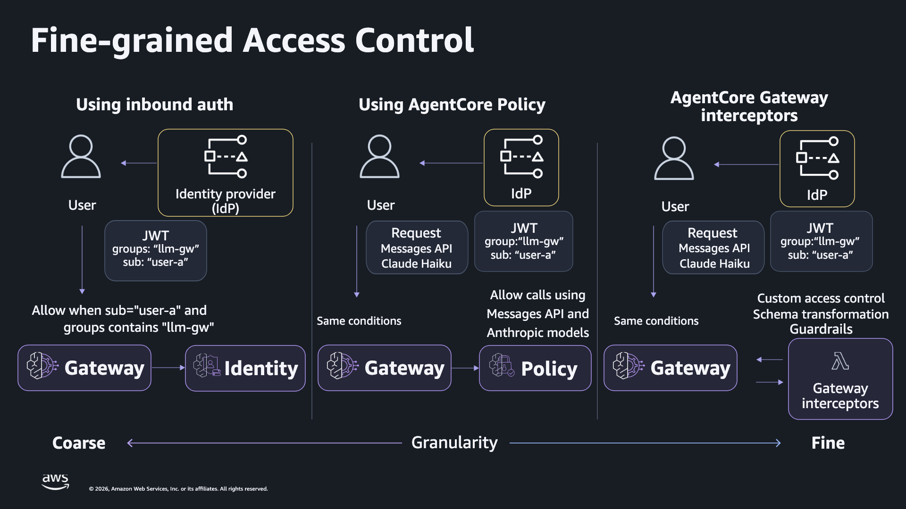
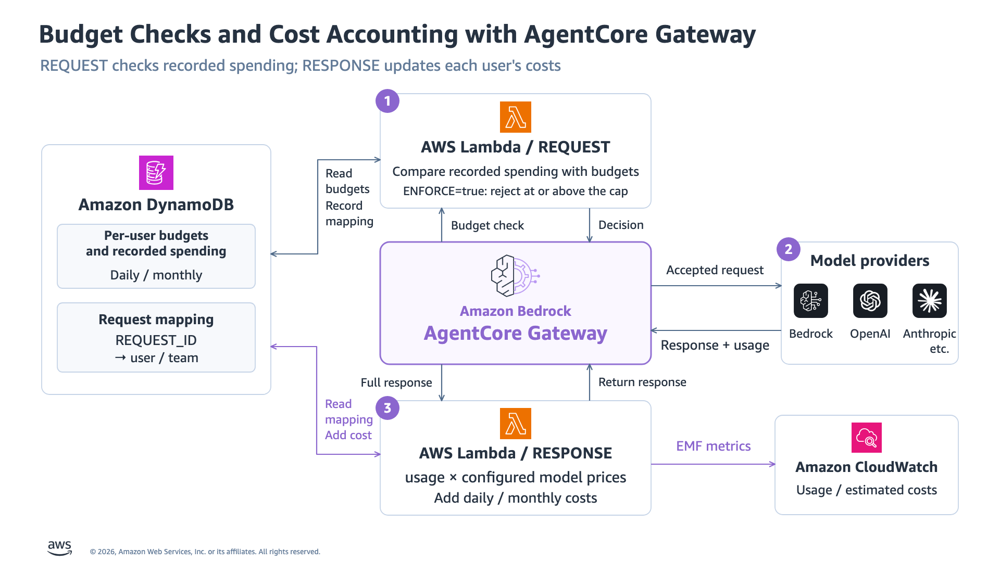

English | [日本語](OPERATIONS_JA.md) | [Quick start](../README.md)

# Runtime V2 operations

Use this guide after selecting a deployment with `AWS_PROFILE`, `AWS_REGION`, and `RUNTIME_V2_STATE`. Run commands from the repository root with the Python environment activated. All commands here concern `runtime_v2/`; legacy root scripts use different resources and state.

## Keep and select an existing environment

Keep the deployment for repeated use. Normal invocation requires neither another `deploy` nor a running local backend.

```bash
source .venv/bin/activate
export AWS_PROFILE="<original-profile>"
export AWS_REGION="<original-region>"
export RUNTIME_V2_STATE="<absolute-path-to-existing-state.json>"
python runtime_v2/manage.py status
python runtime_v2/manage.py budget --user employee
```

Confirm Runtime/Gateway `READY`, platform `V2`, Policy `ENFORCE`, and both interceptor points. Record `runtime_version`, check `rate_status="ACTIVE"` and `rate_entries` against the saved limits, and check `verification_recovery_pending`. A true value indicates a local recovery file; follow [recovery](#resume-and-recovery) before verification. The wrapper checks the account and Region against saved state. Do not edit state to bypass a mismatch.

The environment variable selects state for `manage.py`, `verify.py`, and `cleanup.py`. An explicit path is also supported: `python runtime_v2/manage.py --state "$RUNTIME_V2_STATE" status`. For `manage.py`, `--state` precedes the subcommand. Use a separate directory for each deployment because reports and `client.json` use fixed filenames beside state.

## Private files

Keep the entire state directory together and backed up in private storage. The wrapper writes state, credentials, and verification JSON with mode `0600`. Git ignores `results/`, `local/`, `build/`, and `.venv/`; this does not protect copies placed elsewhere.

| File | Purpose |
|---|---|
| Selected state JSON | Account/Region, owned resources, configuration, user subjects, deployment progress |
| `<state-stem>-credentials.json` | Demonstration-user passwords used by `manage.py invoke` |
| `client.json` | Region, CLI app-client ID, Runtime URL; no password or JWT |
| `verification.json` | Current live-check assertions, model/service responses, terminal status, and timestamps |
| `verification-history/` | Prior reports archived before a new verification run |
| `verification-rate-recovery.json` | Original rate entries and recorded probe identity; keep it until recovery succeeds |
| `stack-failure.json` | CloudFormation failure details when deployment reaches that failure path |

Keep model output and service errors private too. They may contain work information or resource identifiers. Share only the client configuration and each user's own sign-in information with that user, never the full credentials bundle or state. The agent does not add JWTs to model prompts or result bodies.

## End-user client

[client.py](client.py) signs in to Cognito and calls the hosted Runtime. End users need Python and HTTPX, but no AWS SDK credentials or operator profile. The operator provides the exported `client.json`, the user's username, and only that user's password through a secure channel.

Save the received configuration as `local/client.json` in the user's repository copy, then run:

```bash
python -m pip install "httpx==0.28.1"
python runtime_v2/client.py --config local/client.json \
  --username employee --model standard \
  --task "Plan an onboarding session. Record two work items, inspect them, and give a short plan."
```

Replace `employee` with the supplied username. The client prompts for the password with `getpass`; do not put it in shell arguments or configuration. Use `premium` only for an authorized user. Each invocation signs in and uses a new Runtime session ID.

The CLI uses a separate Cognito app client with `USER_PASSWORD_AUTH`. The upstream browser app client and its PKCE flow remain in the deployment. Client endpoints come from the operator's export, not user-supplied task text.

## Responses and stops

The hosted agent accepts exactly two JSON fields:

```json
{
  "task": "Prepare a short plan using only the supplied information.",
  "model": "standard"
}
```

It calls `record_work_item(title, detail)` and `list_work_items()` as in-memory note tools. History and work items are discarded at the end of each invocation. Messages uses `tool_use` / `tool_result`; Responses uses `function_call` / `function_call_output`. Native output items are preserved when continuing the conversation.

The model requests use `stream: false`. Runtime returns one JSON result after the bounded loop finishes. Both `manage.py invoke` and `client.py` print an outer `http_status` and `result`:

| Field | Meaning |
|---|---|
| Outer `http_status` | HTTP status received from Runtime |
| `result.status` | `completed` or `stopped` for handled task outcomes |
| `result.http_status` | Task outcome code, including a refusal or application bound |
| `result.gateway_status` | Gateway status when available; may be null after transport failure |
| `result.stop_reason` | Stop classification; null for completion |
| `result.answer` / `work_items` | Final or partial text and recorded notes |
| `result.model_calls` | Attempt count, including refusals and transport failures |

Handled task outcomes use outer HTTP `200` so refusal details and partial work remain visible. Runtime can replace non-2xx container responses with a service error such as HTTP `424`; inbound JWT/group failures remain HTTP `401`/`403`. Preserve the whole response when the expected task fields are absent.

| Stop reason | Task code | Operator action |
|---|---|---|
| `BUDGET_EXCEEDED` | `403` | Inspect recorded spending and both caps; do not immediately retry. |
| `POLICY_DENIED` | `403` | Check the user's permitted alias; do not bypass Policy. |
| `ACCESS_DENIED` / `AUTHENTICATION_FAILED` | `403` / `401` | Inspect identity and permissions; an unclassified refusal is not proof of budget exhaustion. |
| `RATE_LIMITED` | `429` | Wait for the traffic restriction to clear before deciding whether to resubmit. |
| `MAX_MODEL_CALLS` / `MAX_OUTPUT_TOKENS` | `409` | Keep partial work and reduce the next task's scope. |
| `GATEWAY_TIMEOUT` / `GATEWAY_CONNECTION_ERROR` | `504` / `502` | Check whether processing or accounting occurred before resubmitting. |

Other model/tool validation stops are defined in [agent.py](agent.py). Neither client nor agent retries or switches models automatically. A stopped task exits the CLI with code `2`, even when Runtime returned HTTP `200`; `completed` with HTTP `200` exits `0`. Unhandled setup/sign-in errors can exit differently.

## Authentication and model routing



Both Runtime and Gateway accept the configured Cognito clients and require `llm-gateway-access`. Runtime's header allowlist exposes `Authorization` to the container; the agent explicitly copies it into each Gateway request. Gateway authorizes the user's JWT and signs the Bedrock request with its own execution role.

Policy matches the JWT `sub`, Gateway resource, API action, and exact `context.input.model`. Employee permissions name only the added `bedrock-models` target. `restricted` has only the standard permit, while `outsider` fails the group requirement.

| Alias | Gateway path | Provider path |
|---|---|---|
| `standard` / Messages | `/inference/v1/messages` | `/anthropic/v1/messages` |
| `premium` / Responses | `/inference/v1/responses` | `/openai/v1/responses` |

The original `bedrock-mantle` target remains deployed. The coworker's Policy selects the added provider. Deployment resolves the selected inference profiles with `GetInferenceProfile`, checks `ACTIVE`, and grants the Gateway role access to the profiles, underlying foundation models, and `project/default`. Existing interceptor permissions remain.

Runtime's execution policy covers artifacts, logs, and workload identity. The agent has no DynamoDB/IAM tools or direct Bedrock invocation permissions. Task text cannot change the server's model catalog, endpoint, tools, or limits.

## Budgets and accounting

Read recorded spending, or explicitly set the employee's daily and monthly overrides to USD 10:

```bash
python runtime_v2/manage.py budget --user employee
python runtime_v2/manage.py budget --user employee --daily 10 --monthly 10
```

The second command writes caps using the operator's AWS permissions; it does not reset accumulated spending. Both limits apply independently, so two USD 10 caps are not USD 20 of budget. Missing overrides use the stack defaults. Multiple agents using the same user's JWT share its counters.

Spending uses DynamoDB `pk=USER#<sub>`. A new user may have no row yet. REQUEST caches the complete user state for 60 seconds, so updated caps or spending may not affect every Lambda execution environment immediately.



| Constraint | Consequence |
|---|---|
| Cost is recorded after a response | The final request, concurrent requests, and cached state can cause overspending. There is no reservation or cancellation at exactly USD 10. |
| REQUEST reads can fail open | A DynamoDB read failure may use stale state or zero spending without a cached value. |
| RESPONSE writes can fail open | Recording errors are logged and the model response passes through. Task success alone does not prove accounting succeeded. |
| Prices are supplied configuration | Verify USD-per-1,000-token rates for each requested and returned model ID against the applicable pricing. |
| Cache usage depends on the parser | The pinned parser does not separately account for Responses `input_tokens_details.cached_tokens`; those inputs use the regular input rate. |
| Counters cover model usage only | Runtime, Gateway, Lambda, DynamoDB, storage, logs, other services, and billing adjustments are outside these totals. |

The example price table includes `global.*` inference-profile IDs and plain response-model aliases. Check actual responses, including versioned model IDs, before relying on those mappings. Each entry requires `in`, `out`, `cache_read`, `cache_write_5m`, and `cache_write_1h`. Extending usage formats or price categories requires changes to upstream `_extract_usage` / `_cost`; this wrapper leaves them unchanged.

Upstream rollover archives spending to S3 and rolls daily/monthly counters over using its unchanged `Etc/UTC` timezone. This sample enforces user budgets, not task, project, or team shared budgets.

Rate limits are a separate traffic control. The supplied configuration uses per-`sub` request and connection metrics across both aliases. Enforcement is approximate, eventually consistent, and can fail open; it does not ensure a spending ceiling. See [rate enforcement](https://docs.aws.amazon.com/bedrock-agentcore/latest/devguide/gateway-rate-limits-enforcement.html).

## Verification and manual checks

Run the live verifier only after checking status and remaining budget:

```bash
python runtime_v2/verify.py
```

This is a functional AWS test with billable model calls and temporary resource changes. It verifies the configuration and role, rejects invalid JWTs and missing groups at both boundaries, exercises both model/tool loops, compares spending, checks Policy and rate refusals, and exercises budget rejection.

The rate probe appends exact-subject entries to the owned rate limit, retaining the normal wildcard entries. It temporarily uses zero request/connection limits to test rejection, not throughput or real concurrent load. The budget probe sets a dedicated user's recorded spending and caps to USD 10. It does not generate USD 10 of inference costs or change employee caps.

The script waits for propagation and REQUEST's cache. Its `finally` block uses the same recovery function as `restore-verification` to restore rate entries and disable the recorded probe. The probe's spending row and identity remain as evidence. A hard process termination can prevent those steps. Verification refuses to proceed while a recovery file remains. Do not run concurrent verification processes.

Before each run, the CLI archives the previous `verification.json` under `verification-history/`. During checks the status is `RUNNING`. Completion records `PASSED` or `FAILED`; a caught keyboard interruption records `INTERRUPTED`. Terminal reports include `started_at` and `completed_at` in UTC. Failure/interruption reports also include `error` and `recovery_pending`. A hard termination may leave `RUNNING`.

Require both `status="PASSED"` and `passed: true` in the new report, and inspect its checks, evidence, and timestamps. The latest management and verification changes have not yet had a new AWS E2E run. Historical results in [VERIFICATION.md](VERIFICATION.md) do not validate these changes. Keep current and archived reports private.

For a small manual comparison:

```bash
python runtime_v2/manage.py budget --user employee
python runtime_v2/manage.py invoke --user employee --model standard \
  --task "Record two onboarding preparation items, inspect the notes, and summarize the plan."
python runtime_v2/manage.py budget --user employee
```

- Check `completed`, a nonempty `answer`, recorded `work_items`, and the call count. Model output may hit an application bound even with a valid prompt.
- Compare spending before and after. DynamoDB is the budget input; a successful model response alone is insufficient evidence of cost recording.
- In CloudWatch, inspect the RESPONSE function identified by state `stack_resources.ResponseInterceptorFunction` for usage EMF and accounting errors. The automated EMF assertion searches recent positive-cost events; it does not alone establish per-invocation attribution.
- Compare `restricted` on standard and premium, then `outsider` on standard using the same `invoke` command. Expected refusals exit nonzero; do not treat them as successful task completion.

Offline checks are separate and make no live-deployment claim:

```bash
python -m unittest discover -s tests -p 'test_runtime_v2*.py' -v
```

## Resume and recovery

Keep state after any partial failure. To resume deployment or deploy code changes, export the configuration saved with that state. This preserves the deployment's models, prices, and limits even if `config.example.json` has changed. If the agent artifact changed, `deploy` updates Runtime and waits for V2 readiness.

```bash
python runtime_v2/manage.py export-config --output local/runtime-v2-saved-config.json &&
python runtime_v2/manage.py deploy --config local/runtime-v2-saved-config.json &&
python runtime_v2/manage.py status
```

`export-config` writes only the saved configuration with mode `0600`; it does not export user passwords or the complete state. It requires the selected AWS environment to match state and refuses to overwrite an existing output. Choose a new output filename and use that same filename with `deploy`. The `&&` chain prevents deployment if export fails.

If `status` reports `verification_recovery_pending=true`, inspect the private recovery record, then restore the interrupted verification:

```bash
python runtime_v2/manage.py restore-verification --yes &&
python runtime_v2/manage.py status
```

Recovery validates the recorded Gateway/rate ownership and entries against the saved configuration, restores the owned rate limit, and disables the recorded probe user. It deletes no AWS resources or spending evidence. The recovery file is removed only after restoration and any recorded probe disabling succeed. Check `rate_status="ACTIVE"`, restored `rate_entries`, and `verification_recovery_pending=false` before another verification.

| Situation | Recovery |
|---|---|
| Account/Region mismatch | Select the original profile and Region; leave state intact. |
| Different configuration | Use the saved configuration to resume. Deliberate configuration changes need a separate state directory and deployment. |
| CloudFormation failed/rolled back | Preserve state and `stack-failure.json`; resolve the specific stack failure. Rerunning does not automatically repair a rolled-back stack. |
| Runtime not ready | Inspect its service status and failure reason. Retry deployment only after identifying the cause. |
| Rate recovery file remains | Run `restore-verification --yes` using the same state. On error, retain the file and resolve the reported mismatch/failure before retrying. |
| Older recovery record has no `probe_username` | The command can restore rate entries but cannot identify a probe to disable. Inspect the dedicated Cognito pool and state for that older probe. |
| State marked `deleted` | It cannot be used for a new deployment. Keep it as a retained-resource inventory and use a new directory for new resources. |

Do not edit or remove recovery evidence to bypass a failed ownership/configuration check, or replace entries with guessed limits. Save relevant logs for accounting failures or uncertain timeouts; this sample does not automatically reconcile missing usage or ambiguous calls. Normal reuse and verification recovery retain the deployment; do not run `cleanup.py` as part of either procedure.

## Cleanup and retained resources

Cleanup is optional. Leave resources deployed while continuing to use the environment. When deletion is explicitly intended, select its original profile, Region, and state and run:

```bash
python runtime_v2/cleanup.py --yes
```

[cleanup.py](cleanup.py) verifies recorded ownership, removes Runtime and the added provider/rate/Policy resources, deletes the upstream stack, and removes the Runtime role and artifact bucket. It retains local state and marks it `deleted` only after finishing.

The upstream template declares `DeletionPolicy: Retain` for the spend table, KMS key, rollover archive bucket, and Lambda versions. CloudWatch logs are also outside the cleanup purge. The completion message is not a complete inventory of remaining resources.

Use private state `stack_resources` and actual AWS resources to decide what to keep. Retained data and resources can continue to incur charges. Keep the KMS key while encrypted archives, tables, or backups need it. Dispose of retained resources and local private files separately only when no longer needed.

## Implementation and provenance

Operational behavior comes from [manage.py](manage.py), [verify.py](verify.py), [client.py](client.py), [agent.py](agent.py), and [cleanup.py](cleanup.py). Models, prices, and limits are in [config.example.json](config.example.json).

The unmodified template and Lambda code are pinned to upstream commit `d79bd57f6d5461b81f862630961b72c49967a4f9`; [SOURCE.json](vendor/usage-interceptor/SOURCE.json) records the hash and provenance. See the [upstream configuration guide](https://github.com/aws-samples/sample-agentcore-gateway-usage-interceptor/blob/d79bd57f6d5461b81f862630961b72c49967a4f9/docs/configuration.md), [upstream license](vendor/usage-interceptor/LICENSE), and [wrapper license](../LICENSE).
