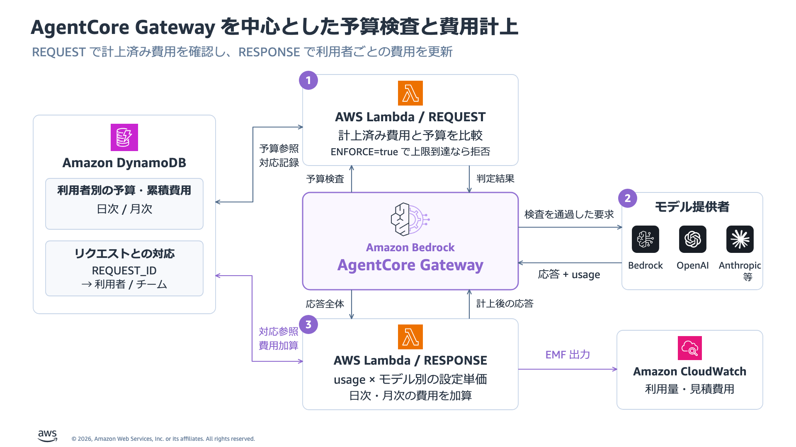

[English](OPERATIONS.md) | 日本語 | [クイックスタート](../README_JA.md)

# Runtime V2 運用手順

`AWS_PROFILE`、`AWS_REGION`、`RUNTIME_V2_STATE` で対象環境を選択してから使う。コマンドは Python 環境を有効化し、リポジトリのルートで実行する。本手順は `runtime_v2/` を対象とし、資源と状態が異なるルートの旧スクリプトは使わない。

## 既存環境を保持して選択する

繰り返し利用する環境は保持する。通常の呼び出しに `deploy` の再実行やローカルのバックエンド起動は不要である。

```bash
source .venv/bin/activate
export AWS_PROFILE="<original-profile>"
export AWS_REGION="<original-region>"
export RUNTIME_V2_STATE="<absolute-path-to-existing-state.json>"
python runtime_v2/manage.py status
python runtime_v2/manage.py budget --user employee
```

Runtime / Gateway の `READY`、platform の `V2`、Policy の `ENFORCE`、両 interceptor point を確認する。`runtime_version` を記録し、`rate_status="ACTIVE"` と `rate_entries` が保存済み上限に対応することを確認する。`verification_recovery_pending` が true ならローカルに復旧ファイルがあるため、検証前に [復旧](#再開と復旧) を行う。Wrapper は保存済み状態とアカウント・リージョンを照合する。不一致を回避するために状態を編集しない。

環境変数は `manage.py`、`verify.py`、`cleanup.py` の状態を指定する。`python runtime_v2/manage.py --state "$RUNTIME_V2_STATE" status` のように明示指定もできる。`manage.py` の `--state` はサブコマンドの前に置く。レポートと `client.json` は状態ファイルの隣へ固定名で保存するため、環境ごとにディレクトリを分ける。

## 非公開ファイル

状態ディレクトリ全体をまとめて保管し、非公開の保存先にバックアップする。Wrapper は状態、認証情報、検証 JSON を mode `0600` で保存する。`results/`、`local/`、`build/`、`.venv/` は Git 対象外だが、別の場所へコピーしたファイルまで保護するものではない。

| ファイル | 用途 |
|---|---|
| 指定した状態 JSON | アカウント・リージョン、所有資源、設定、利用者の主体、配置の進捗 |
| `<state-stem>-credentials.json` | `manage.py invoke` が使うデモ利用者のパスワード |
| `client.json` | リージョン、CLI app-client ID、Runtime URL。パスワードや JWT は含まない |
| `verification.json` | 今回の実機検証の判定、モデル・サービス応答、終了状態、日時 |
| `verification-history/` | 新しい検証の開始前に退避する過去のレポート |
| `verification-rate-recovery.json` | 変更前の rate entry と記録した probe の主体。復旧成功まで保持 |
| `stack-failure.json` | 対応する失敗経路で保存する CloudFormation の失敗情報 |

モデル出力とサービスエラーも非公開で扱う。仕事の情報やリソース識別子を含む場合がある。利用者へは client 設定と本人のサインイン情報だけを渡し、認証情報一式や状態ファイルは共有しない。エージェントは JWT をモデルのプロンプトや結果本文へ追加しない。

## 利用者向け client

[client.py](client.py) は Cognito にサインインし、ホスト済み Runtime を呼び出す。利用者には Python と HTTPX が必要だが、AWS SDK の認証情報や管理者プロファイルは不要である。管理者は出力済み `client.json`、本人のユーザー名、本人のパスワードだけを安全な経路で渡す。

受け取った設定を利用者側リポジトリの `local/client.json` に保存し、次を実行する。

```bash
python -m pip install "httpx==0.28.1"
python runtime_v2/client.py --config local/client.json \
  --username employee --model standard \
  --task "新人研修を計画してください。作業項目を 2 件記録し、一覧を確認して短い計画を返してください。"
```

`employee` は提供されたユーザー名へ置き換える。Client は `getpass` でパスワードを入力させるため、シェル引数や設定ファイルへ記載しない。`premium` は権限を持つ利用者だけが使う。呼び出しごとにサインインし、新しい Runtime session ID を使う。

CLI は `USER_PASSWORD_AUTH` を有効にした専用の Cognito app client を使う。Upstream のブラウザー向け app client と PKCE flow は保持する。Client の endpoint は管理者から受け取る設定であり、タスク本文からは指定しない。

## 応答と停止理由

ホストするエージェントは、次の 2 フィールドだけを受け付ける。

```json
{
  "task": "提供した情報だけを使い、短い計画を作成してください。",
  "model": "standard"
}
```

`record_work_item(title, detail)` と `list_work_items()` はメモリ内のメモ操作である。会話履歴と作業項目は各 invocation の終了時に破棄する。Messages は `tool_use` / `tool_result`、Responses は `function_call` / `function_call_output` を使い、会話の継続時には API 固有の出力項目を保持する。

モデル要求は `stream: false` を使う。Runtime は上限付きループ終了後に JSON 結果を 1 つ返す。`manage.py invoke` と `client.py` は、外側の `http_status` と `result` を出力する。

| フィールド | 意味 |
|---|---|
| 外側の `http_status` | Runtime から受信した HTTP status |
| `result.status` | 処理済みのタスク結果を示す `completed` または `stopped` |
| `result.http_status` | 拒否やアプリケーション上限を含むタスク結果の code |
| `result.gateway_status` | 取得できた Gateway status。通信失敗時は null の場合がある |
| `result.stop_reason` | 停止の分類。完了時は null |
| `result.answer` / `work_items` | 最終・途中の文章と記録済みのメモ |
| `result.model_calls` | 拒否や通信失敗を含む試行回数 |

処理済みのタスク結果は外側の HTTP `200` で返し、拒否の詳細と途中成果を保持する。コンテナの非 2xx 応答は、Runtime が HTTP `424` などのサービスエラーへ置き換える場合がある。Inbound の JWT・グループ拒否は HTTP `401` / `403` である。想定したタスクのフィールドがない場合は、応答全体を保管する。

| 停止理由 | タスクの code | 管理者の対応 |
|---|---|---|
| `BUDGET_EXCEEDED` | `403` | 計上済み費用と両上限を確認し、即時再試行を繰り返さない |
| `POLICY_DENIED` | `403` | 利用者に許可した alias を確認し、Policy を回避しない |
| `ACCESS_DENIED` / `AUTHENTICATION_FAILED` | `403` / `401` | 主体と権限を確認する。未分類の拒否だけで予算到達と判断しない |
| `RATE_LIMITED` | `429` | 利用量の制限が解除されるまで待ち、再送の要否を判断 |
| `MAX_MODEL_CALLS` / `MAX_OUTPUT_TOKENS` | `409` | 途中成果を保存し、次の依頼を小さくする |
| `GATEWAY_TIMEOUT` / `GATEWAY_CONNECTION_ERROR` | `504` / `502` | 再送前にモデル処理や費用計上の有無を確認 |

その他のモデル・ツール検証による停止は [agent.py](agent.py) で定義する。Client とエージェントは再試行やモデル切り替えを自動実行しない。タスク停止時の CLI 終了コードは、外側の HTTP が `200` でも `2` である。HTTP `200` かつ `completed` の場合だけ `0` を返す。未処理の初期化・サインインエラーでは別の終了コードを返す場合がある。

## 認証とモデルへの接続


Runtime と Gateway は設定した Cognito client の JWT を受け入れ、`llm-gateway-access` への所属を要求する。Runtime の header allowlist で `Authorization` をコンテナへ渡し、エージェントが各 Gateway 要求へ明示的にコピーする。Gateway は利用者の JWT で認可し、自身の実行ロールで Bedrock 要求を署名する。

Policy は JWT の `sub`、Gateway リソース、API action、正確な `context.input.model` を照合する。Employee の権限は追加した `bedrock-models` target だけを指定する。`restricted` は standard の permit だけを持ち、`outsider` はグループ要件を満たさない。

| Alias | Gateway パス | Provider パス |
|---|---|---|
| `standard` / Messages | `/inference/v1/messages` | `/anthropic/v1/messages` |
| `premium` / Responses | `/inference/v1/responses` | `/openai/v1/responses` |

元の `bedrock-mantle` target は配置したまま保持する。AI 社員の Policy は追加した provider を対象とする。配置時に `GetInferenceProfile` で選択した profile を取得して `ACTIVE` を確認し、Gateway ロールに profile、参照先 foundation model、`project/default` への権限を追加する。既存の interceptor 権限も保持する。

Runtime の実行ポリシーは配置物、ログ、workload identity を扱う。エージェントには DynamoDB / IAM のツールや Bedrock の直接呼び出し権限を持たせない。タスク本文からサーバーのモデル一覧、endpoint、ツール、上限は変更できない。

## 予算と費用計上

計上済み費用を確認する。Employee の日次・月次上限を明示的に変更する場合は、各 10 USD を設定する。

```bash
python runtime_v2/manage.py budget --user employee
python runtime_v2/manage.py budget --user employee --daily 10 --monthly 10
```

2 つ目のコマンドは管理者の AWS 権限で上限を書き込み、累積費用はリセットしない。両上限は別々に適用するため、各 10 USD を合計して 20 USD の予算とするものではない。利用者別の上限がなければ stack の既定値を使う。同じ利用者の JWT で動く複数のエージェントは、その利用者のカウンターを共有する。

費用は DynamoDB の `pk=USER#<sub>` に記録する。新規利用者にはまだ行がない場合がある。REQUEST は利用者の状態全体を 60 秒キャッシュするため、上限や費用の変更が全 Lambda 実行環境へ即時反映されるとは限らない。



| 制約 | 影響 |
|---|---|
| 応答後に費用を計上 | 最後の要求、並行要求、キャッシュによって予算を超えうる。事前予約や 10 USD 到達時点での中断は行わない |
| REQUEST の読み取りに fail-open 経路がある | DynamoDB の読み取り失敗時に古い状態を使い、キャッシュがなければ費用を 0 と扱う場合がある |
| RESPONSE の書き込みに fail-open 経路がある | 計上エラーをログに残してモデル応答を通す。タスク成功だけでは計上成功を証明できない |
| 単価は設定値 | 要求・応答の各モデル ID に適用する 1,000 トークンあたりの USD 単価を確認する |
| キャッシュ料金は parser に依存 | 固定版 parser は Responses の `input_tokens_details.cached_tokens` を別計上せず、通常の入力単価で扱う |
| カウンターはモデル usage だけを対象とする | Runtime、Gateway、Lambda、DynamoDB、ストレージ、ログなどの料金と請求上の調整は含まない |

設定例には `global.*` の inference profile ID と、応答のモデル別名を含めている。Version 付きのモデル ID も含め、実際の応答との対応を確認する。各 entry は `in`、`out`、`cache_read`、`cache_write_5m`、`cache_write_1h` を必要とする。Usage 形式や料金区分を拡張する場合は upstream の `_extract_usage` / `_cost` の変更が必要だが、この wrapper は変更しない。

Upstream の rollover は、費用を S3 へ保存して日次・月次カウンターを更新する。タイムゾーンは既定の `Etc/UTC` を変更しない。本サンプルが制御するのは利用者予算であり、タスク・プロジェクト・チーム共有予算ではない。

Rate limit は別の利用量制御である。設定例は両 alias を共通に扱い、`sub` ごとに requests と connections を制限する。制御は近似的・結果整合的で、fail-open になる場合もあるため、費用の厳密な上限保証には使えない。[Rate enforcement](https://docs.aws.amazon.com/bedrock-agentcore/latest/devguide/gateway-rate-limits-enforcement.html) を参照する。

## 検証と手動チェック

Status と残予算を確認してから実機検証を実行する。

```bash
python runtime_v2/verify.py
```

これは課金対象のモデル呼び出しと一時的な資源変更を伴う AWS 機能検証である。設定とロール、両境界での不正 JWT・グループ未所属拒否、両モデルのツールループ、費用の増加、Policy・rate limit 拒否、予算到達時の拒否を確認する。

Rate probe は所有する rate limit に主体を限定した entry を追加し、通常の wildcard entry を維持する。Requests / connections の上限を一時的に 0 にして拒否を確認するため、throughput や実際の並行負荷の検証ではない。予算 probe は専用利用者の計上済み費用と上限を 10 USD に設定し、10 USD の推論費用を発生させたり employee の上限を変更したりはしない。

スクリプトは設定の反映と REQUEST のキャッシュを待つ。`finally` は `restore-verification` と同じ復旧関数で rate entry を復元し、記録した probe を無効化する。Probe の費用行と主体は記録として残す。プロセスの強制終了ではこれらが実行されない場合がある。復旧ファイルが残る間、検証は続行を拒否する。複数の検証プロセスを同時に動かさない。

CLI は開始前に前回の `verification.json` を `verification-history/` へ退避する。チェック実行中は `RUNNING`、終了時は `PASSED` または `FAILED` を記録し、捕捉できたキーボード割り込みは `INTERRUPTED` として記録する。終了レポートは UTC の `started_at` と `completed_at` を含む。失敗・中断時は `error` と `recovery_pending` も記録する。強制終了では `RUNNING` のまま残る場合がある。

新しいレポートで `status="PASSED"` と `passed: true` の両方を確認し、各チェック、実行記録、日時を読む。最新の管理・検証機能の変更について、新しい AWS E2E 検証はまだ実施していない。[VERIFICATION.md](VERIFICATION.md) の過去の結果から変更後の成功を判断しない。現在と過去のレポートは非公開で保管する。

小規模な手動比較では、呼び出しの前後で費用を確認する。

```bash
python runtime_v2/manage.py budget --user employee
python runtime_v2/manage.py invoke --user employee --model standard \
  --task "新人研修の準備項目を 2 件記録し、一覧を確認して計画をまとめてください。"
python runtime_v2/manage.py budget --user employee
```

- `completed`、空でない `answer`、記録済みの `work_items`、呼び出し回数を確認する。有効な入力でもアプリケーション上限に達する場合がある。
- 呼び出し前後の費用を比較する。予算検査が参照するのは DynamoDB であり、モデル応答の成功だけでは計上を確認できない。
- 状態の `stack_resources.ResponseInterceptorFunction` が示す RESPONSE 関数の CloudWatch Logs で usage EMF と計上エラーを確認する。自動検証の EMF 判定は直近の正の費用イベントを検索するため、それだけでは個別 invocation との対応を証明できない。
- 同じ `invoke` コマンドで restricted の standard / premium と、outsider の standard を比較する。期待した拒否も非ゼロの終了コードを返すため、タスク成功と混同しない。

オフライン検証は別に実行し、その結果から実機環境の成功を判断しない。

```bash
python -m unittest discover -s tests -p 'test_runtime_v2*.py' -v
```

## 再開と復旧

途中で失敗した場合も状態を保持する。配置の再開やコード変更の反映では、その状態に保存した設定を出力する。`config.example.json` が変わっていても、構築時のモデル、単価、上限を維持できる。エージェントの配置物が変わっていれば、`deploy` は Runtime を更新して V2 の準備完了を待つ。

```bash
python runtime_v2/manage.py export-config --output local/runtime-v2-saved-config.json &&
python runtime_v2/manage.py deploy --config local/runtime-v2-saved-config.json &&
python runtime_v2/manage.py status
```

`export-config` は保存済み設定だけを mode `0600` で出力し、利用者のパスワードや状態全体は出力しない。選択した AWS 環境と状態の一致が必要であり、既存の出力ファイルは上書きしない。新しいファイル名を選び、`deploy` にも同じ名前を指定する。`&&` で接続しているため、export が失敗すれば配置しない。

`status` の `verification_recovery_pending=true` を確認した場合は、非公開の復旧記録を確認してから中断した検証を復旧する。

```bash
python runtime_v2/manage.py restore-verification --yes &&
python runtime_v2/manage.py status
```

復旧は記録した Gateway / rate の所有権と、entry が保存済み設定に対応することを検証し、所有する rate limit を復元して記録済み probe を無効化する。AWS 資源や費用の記録は削除しない。復旧ファイルは復元と、記録がある場合の probe 無効化が成功した後にだけ除去する。次の検証前に `rate_status="ACTIVE"`、復元済みの `rate_entries`、`verification_recovery_pending=false` を確認する。

| 状況 | 復旧方法 |
|---|---|
| アカウント・リージョン不一致 | 元のプロファイル・リージョンを選び、状態は保持 |
| 設定の不一致 | 保存済み設定で再開する。意図的な設定変更には別の状態ディレクトリと環境を使用 |
| CloudFormation の失敗・rollback | 状態と `stack-failure.json` を保管し、個別の stack 失敗を解消する。再実行だけで rollback 済み stack が修復されるとは限らない |
| Runtime が準備未完了 | サービスの状態と失敗理由を確認し、原因を特定してから配置を再試行 |
| Rate 復旧ファイルが残存 | 同じ状態で `restore-verification --yes` を実行する。エラー時はファイルを保持し、不一致や失敗の原因を解消してから再試行 |
| 古い復旧記録に `probe_username` がない | コマンドは rate entry を復元できるが、無効化する probe を特定できない。専用 Cognito pool と状態から古い probe を確認 |
| 状態が `deleted` | 新規配置には再利用しない。保持資源の記録として保存し、新しい資源には別ディレクトリを使用 |

所有権や設定の不一致を回避するために復旧記録を編集・削除したり、entry を推測した上限へ置き換えたりしない。計上失敗や結果不明のタイムアウトでは関連ログを保存する。本サンプルに未計上 usage や結果不明の呼び出しを自動照合・復旧する機能はない。通常の再利用と検証復旧では環境を保持し、手順の一部として `cleanup.py` を実行しない。

## Cleanup と保持資源

Cleanup は任意である。継続利用する間は資源を保持する。削除を明示的に決めた場合だけ、元のプロファイル・リージョン・状態を選択して実行する。

```bash
python runtime_v2/cleanup.py --yes
```

[cleanup.py](cleanup.py) は記録した所有権を検証し、Runtime、追加した provider / rate / Policy 資源、upstream stack、Runtime role、artifact bucket を削除する。ローカル状態は保持し、処理完了後にだけ `deleted` を記録する。

Upstream template は費用テーブル、KMS key、rollover archive bucket、Lambda version に `DeletionPolicy: Retain` を指定する。CloudWatch Logs も削除対象外である。完了メッセージは残存資源の完全な一覧ではない。

非公開の状態の `stack_resources` と実際の AWS 資源から、保持する対象を判断する。保持したデータや資源には料金が発生し続ける場合がある。暗号化した archive、table、backup が必要とする間は KMS key を保持する。保持資源とローカルの非公開ファイルは、不要と判断した後に別途処分する。

## 実装と原典

運用上の挙動は [manage.py](manage.py)、[verify.py](verify.py)、[client.py](client.py)、[agent.py](agent.py)、[cleanup.py](cleanup.py) に基づく。モデル、単価、上限は [config.example.json](config.example.json) を参照する。

未変更のテンプレートと Lambda コードは upstream commit `d79bd57f6d5461b81f862630961b72c49967a4f9` に固定し、[SOURCE.json](vendor/usage-interceptor/SOURCE.json) に hash と出典を記録する。[Upstream 設定ガイド](https://github.com/aws-samples/sample-agentcore-gateway-usage-interceptor/blob/d79bd57f6d5461b81f862630961b72c49967a4f9/docs/configuration.md)、[upstream ライセンス](vendor/usage-interceptor/LICENSE)、[wrapper ライセンス](../LICENSE) も参照する。
